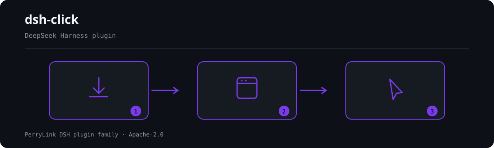

<div align="center">

# 🖱️ dsh-click
- **1024 स्टोर चैनल**: एक बार `npm i -g dsh1024`, फिर `dsh1024 plugin --profile web add dsh-click` ([deepseek1024.com](https://deepseek1024.com) इंस्टॉल रैंकिंग में गिना जाता है)।

**DeepSeek Harness के लिए क्रॉस-प्लेटफ़ॉर्म नेटिव डेस्कटॉप नियंत्रण — Windows पहले।**

*पहले स्क्रीन देखें, फिर काम करें — हर क्लिक स्वीकृत, हर क्रिया ऑडिटेड।*

[](LICENSE)
[](https://gitee.com/perrylink/dsh-click)
[](https://github.com/topics/dsh-plugin)
[](https://github.com/PerryLink/dsh-plugin-doctor#verified-徽章)
[](https://dsh.market/)
[](#)
[](https://github.com/PerryLink/dsh-click/actions)
[](https://github.com/PerryLink/dsh-click/releases)
[](https://www.npmjs.com/package/dsh-click)
[](https://www.npmjs.com/package/dsh-click)
[](https://dshfind.com/hi/plugins/PerryLink/dsh-click?ref=badge)

[English](README.md) · [简体中文](README-zh.md) · [Español](README-es.md) · [Português](README-pt.md) · [हिन्दी](README-hi.md)

```sh
dsh plugin --profile <name> add dsh-click
```


</div>

---


**📖 इकोसिस्टम नॉलेज बेस** — मापे गए आँकड़े, मार्केटिंग नहीं: [डेवलपमेंट गाइड · चयन डेटा · रखरखाव मानदंड](https://perrylink.github.io/dsh-plugin-guide/)।

<!-- star-cta -->
## इंस्टॉल और अनइंस्टॉल

- **git चैनल** (नवीनतम `main`): `dsh plugin --profile web add github:PerryLink/dsh-click` — `prepare` स्क्रिप्ट केवल प्रोडक्शन निर्भरताओं से बिल्ड करती है।
- **npm चैनल** (प्रकाशित रिलीज़): `dsh plugin --profile web add dsh-click`।
- **tarball चैनल**: इस रेपो में `pnpm pack`, फिर `dsh plugin --profile web add ./dsh-click-<version>.tgz`।
- **अनइंस्टॉल**: `dsh plugin --profile web remove dsh-click` (या प्रोफ़ाइल पैच से पंक्ति हटाएँ)।

> यदि pnpm इस पैकेज के लिए `ERR_PNPM_IGNORED_BUILDS` दिखाता है (esbuild का हानिरहित प्लेटफ़ॉर्म-बाइनरी सत्यापन), तो अपने `pnpm-workspace.yaml` में `allowBuilds: { esbuild: true }` जोड़ें — `dsh` CLI सटीक स्निपेट प्रिंट करता है।

## ⭐ 如果它帮到了你

यह प्लगइन [DSH प्लगइन परिवार](https://github.com/PerryLink) का हिस्सा है (95 प्लगइन, सभी Apache-2.0)। अगर यह उपयोगी लगे, तो **एक स्टार दें** — इससे कोई सुविधा अनलॉक नहीं होती, पर अगला व्यक्ति इसे खोज में आसानी से पा लेता है।

*English:* part of a 95 plugin family for DeepSeek Harness. If it is useful, **a star helps the next person find it** — nothing is gated behind it.

## What is dsh-click?

DeepSeek Harness के लिए क्रॉस-प्लेटफ़ॉर्म नेटिव डेस्कटॉप नियंत्रण — Windows पहले।

पहले स्क्रीन देखें, फिर काम करें — हर क्लिक स्वीकृत, हर क्रिया ऑडिटेड।



*कार्यप्रवाह: इंस्टॉल → पैनल खोलें → कार्य। नीचे के उदाहरण वास्तविक कमांड सतह का उपयोग करते हैं।*


*वही रन, एनिमेटेड।*

## संगतता

| सतह | स्थिति |
|---|---|
| Harness | DeepSeek Harness `dsh-v0.2.1-alpha.1` (GitHub tag, 2026-09-25 को सत्यापित)। 2026-09-11 को dsh-v0.1.7-alpha.1 master checkout के विरुद्ध सत्यापित (पूर्ण gate chain + profile install smoke)। |
| Node | `^22.19.0 \|\| >=24.0.0` |
| प्लेटफ़ॉर्म | **Windows पहले** (UIAutomation + Win32 इनपुट, बंडल किए गए PowerShell हेल्पर के ज़रिए); macOS/Linux बैकएंड आरक्षित हैं और स्पष्ट कारण के साथ fail-closed होते हैं |
| मॉडल | केवल-टेक्स्ट मॉडल पूरी तरह समर्थित (`screen_read` संरचित टेक्स्ट लौटाता है); विज़न मॉडल को अतिरिक्त रूप से `screen_shot` की छवियाँ मिलती हैं |

## आपको क्या मिलता है

`dsh-click` हार्नेस को नेटिव डेस्कटॉप ऐप्स पर पूरा observe → act लूप देता है:

- **`screen_shot`** — किसी विंडो (या प्राथमिक स्क्रीन) का स्क्रीनशॉट, कॉन्फ़िगर करने योग्य सीमा तक छोटा किया गया। विज़न-सक्षम मॉडल के साथ परिणाम में छवि होती है; अन्यथा टेक्स्ट विवरण केवल-टेक्स्ट मॉडल को चालू रखता है।
- **`screen_read`** — संरचित अवलोकन: विंडो का एक्सेसिबिलिटी ट्री (एलिमेंट आईडी, प्रकार, नाम, आयत, समर्थित पैटर्न) और रंगों सहित पिक्सेल-स्थिति संकेत — सादा टेक्स्ट, किसी छवि मॉडल की आवश्यकता नहीं।
- **`click` / `type` / `scroll` / `key`** — एलिमेंट आईडी या निर्देशांकों द्वारा संबोधित विंडो-स्कोप्ड क्रियाएँ। डिलीवरी UIA invoke को प्राथमिकता देती है और पोस्ट किए गए विंडो संदेशों पर वापस गिरती है — और **कभी अग्रभूमि फ़ोकस नहीं छीनती**।
- **`app_list` / `app_launch`** — चल रहे ऐप्स और उनकी विंडो की सूची; नाम या पथ से एक को लॉन्च करें।

हर परिवर्तनकारी क्रिया एक ही सुरक्षा सीमा पार करती है:

1. **ताज़गी** — क्रिया को `basedOn` अवलोकन उद्धृत करना होगा; कार्य से ठीक पहले विंडो फिर से कैप्चर होती है और स्क्रीन बदलने पर क्रिया अस्वीकार होती है (पिक्सेल-हैश + अधिकतम आयु सीमा)।
2. **स्वीकृति** — डिफ़ॉल्ट रूप से `ctx.approval` हर क्रिया पर पहरा देता है; विंडो-शीर्षक/निष्पादन-पथ regex विशिष्ट विंडो को अनुमति दे सकते हैं (फिर भी ऑडिट होती है)।
3. **प्रक्रिया पहचान** — स्वामी प्रक्रिया का pid और निष्पादन पथ कार्य से पहले **और** बाद में सत्यापित होता है; बदलाव पर परिणाम ज़ोर से अस्वीकार होता है।
4. **ऑडिट** — अवलोकन और क्रियाएँ सत्र लॉग में `dsh-click/observed` / `dsh-click/action` इवेंट के रूप में दर्ज होती हैं (सैनिटाइज़्ड, केवल-लॉग)।

```text
मॉडल                           harness
  │ screen_read ──▶ observationId (+ एलिमेंट, पिक्सेल)        ← संरचित टेक्स्ट
  │ click {basedOn, target} ──▶ ताज़गी जाँच ──▶ स्वीकृति ──▶ हेल्पर (UIA)
  │                             पिक्सेल हैश बदला? ── अस्वीकार + पुनः अवलोकन
  │                             कार्य के बाद pid/exe बदला? ── PROCESS_CHANGED
  │ ◀── कैननिकल JSON + ऑडिट इवेंट (dsh-click/action)
```

## त्वरित शुरुआत

```sh
dsh plugin --profile web add github:PerryLink/dsh-click
```

```sh
# 1. बंडल को अपने प्रोफ़ाइल में इंस्टॉल करें
dsh plugin --profile web add github:PerryLink/dsh-click

# या npm से (प्रकाशित रिलीज़)
dsh plugin --profile web add dsh-click

# 2. पुनः आरंभ करें और पंक्ति सत्यापित करें
dsh --profile web --dump-config | grep -A2 'id: dsh-click'
```

फिर एजेंट से कहें कि वह किसी विंडो को देखे और कार्य करे — हर परिवर्तनकारी क्रिया पर स्वीकृति संकेत दिखता है:

```
> नोटपैड खोलें, "नमस्ते" टाइप करें, फिर स्क्रीन पर जो है उसे वापस पढ़ें।
```

### उदाहरण

ये वास्तविक प्रवेश बिंदु हैं; इंस्टॉल के बाद एक चलाएँ।

#### विस्तृत उदाहरण

**कमांड**

~~~sh
app_list
~~~

**इनपुट**

~~~json
{}
~~~

**आउटपुट**

~~~text
1 running application(s) with windows:
- Demo (pid 4242, C:\Apps\demo.exe)
  - [windowId 1122867] "Demo App" at (10, 20) 800x600
~~~

*स्रोत `plugins/dsh-click/tests/tools.spec.ts:159-185; renderer at src/tools.ts:933-942`*

#### विफलता शाखा

**इनपुट**

~~~text
{}
~~~

**आउटपुट**

~~~text
Error: dsh-click backend unavailable on linux: Linux backend is reserved but not implemented yet (Windows-first); only Windows can act today
~~~

*स्रोत `plugins/dsh-click/src/platform/selection.ts:61-62,81; plugins/dsh-click/src/tools.ts:133-136; plugins/dsh-click/tests/tools.spec.ts:226-245`*

#### संक्षिप्त उदाहरण

- `screen_read`
- `app_list`

## कॉन्फ़िगरेशन

सभी समायोजन Schemastery `Config` फ़ील्ड हैं (cordis.yml से बदले जा सकते हैं)। id-लक्षित ओवरराइड पूरी पंक्ति बदल देता है — ज़रूरत की हर कुंजी फिर से लिखें। `cordis.patch.yml` हर कुंजी को इनलाइन समझाता है।

| कुंजी | डिफ़ॉल्ट | अर्थ |
|---|---|---|
| `requireApproval` | `true` | हर परिवर्तनकारी क्रिया को स्वीकृति के पीछे रखें; ऑब्ज़र्वर कभी नहीं पूछते |
| `autoApproveWindows` | `[]` | विंडो-शीर्षक/निष्पादन-पथ regex जो स्वीकृति प्रश्न छोड़ देते हैं (फिर भी ताज़गी जाँच और ऑडिट) |
| `auditSessionEvents` | `true` | सत्र में `dsh-click/observed`/`dsh-click/action` ऑडिट इवेंट जोड़ें। अनुकूली द्वार बिना-लिफ़ाफ़े वाले hosts (rc.6–rc.8, 0.1.1-rc.2, और अज्ञात प्रकारों पर पठन-विफल-बंद 0.1.2-rc.1) पर append पहले ही छोड़ देता है; ऑडिट append पूरी तरह रोकने के लिए `false` रखें 0.1.2-rc.1 (2026-09-02 को अनुकूलित): सत्र लिफ़ाफ़ा अपना ignorable फ़ील्ड केवल संग्रहीत-लॉग पठन संगतता के लिए रखता है - Session.append अभी भी इसे स्टैम्प नहीं कर सकता, इसलिए गेट व्यवहार अपरिवर्तित है। |
| `focusFallback` | `never` | क्या कोई क्रिया अंतिम उपाय के रूप में लक्ष्य विंडो को अग्रभूमि में ला सकती है (`never` / `allow`) |
| `imageMode` | `auto` | `screen_shot` रेंडरिंग: `auto` (मॉडल छवि स्वीकार करे तो छवि, अन्यथा टेक्स्ट) या `text` |
| `helperTimeoutMs` | `30000` | प्रति हेल्पर-कॉल टाइमआउट ms में (1..300000) |
| `maxHelperOutputBytes` | `25165824` | एक हेल्पर प्रतिक्रिया की बाइट सीमा (1024..67108864) |
| `maxScreenshotSide` | `2560` | कैप्चर की सबसे लंबी भुजा पिक्सेल में (320..7680); बड़ी कैप्चर छोटी की जाती हैं |
| `staleCheckPixels` | `true` | हर क्रिया से पहले ताज़ा पिक्सेल हैश मिलाएँ और बदलाव पर अस्वीकार करें |
| `staleCheckTree` | `target` | ट्री ताज़गी: `target` लक्ष्य तत्व जाँचता है (डिफ़ॉल्ट), `strict` किसी भी बदले नोड पर अस्वीकार, `off` ट्री हैश छोड़ता है |
| `maxObservationAgeMs` | `30000` | किसी अवलोकन की अधिकतम आयु ms में जिसे कोई क्रिया उद्धृत कर सकती है (1000..600000) |
| `maxCachedObservations` | `8` | कैश किए गए अवलोकनों की LRU सीमा (1..64) |
| `maxElements` | `500` | प्रति `screen_read` एक्सेसिबिलिटी एलिमेंट की सीमा (1..2000) |
| `maxTreeDepth` | `32` | एक्सेसिबिलिटी ट्री-वॉक की अधिकतम गहराई (1..64) |
| `maxTextLength` | `200` | सैनिटाइज़्ड मॉडल-दृश्य स्ट्रिंग्स की काट-छाँट लंबाई (16..10000) |
| `rollbackEnabled` | `true` | `type` विफल होने पर नियंत्रण टेक्स्ट का बैकअप और पुनर्स्थापन |
| `ocr.enabled` / `command` / `language` | `true` / `tesseract` / `eng` | `screen_find` के लिए वैकल्पिक OCR (माउंट पर जाँच; tesseract अनुपस्थित होने पर अनुपलब्ध) |

आपके प्रोफ़ाइल पैच में ओवरराइड उदाहरण:

```yaml
- insert:
    - id: dsh-click
      name: dsh-click
      config:
        requireApproval: true
        autoApproveWindows: ['^Notepad']
        focusFallback: never
```

## टूल और सतहें

| टूल | केवल-पठन | स्वीकृति चाहिए | टिप्पणियाँ |
|---|---|---|---|
| `screen_shot` | ✅ | — | `observationId` लौटाता है जिसे बाद की क्रियाएँ `basedOn` में उद्धृत करती हैं; मॉडल छवि स्वीकार करे तो छवि अटैचमेंट |
| `screen_read` | ✅ | — | एक्सेसिबिलिटी ट्री + पिक्सेल संकेत; एलिमेंट आईडी ही क्रियाओं का संबोधन है |
| `click` | | ✅ | `elementId` या `(x, y)` में से ठीक एक; UIA invoke प्राथमिकता, पोस्ट किए संदेश फ़ॉलबैक |
| `type` | | ✅ | केवल value-पैटर्न एलिमेंट; विफलता पर नियंत्रण टेक्स्ट का बैकअप और पुनर्स्थापन |
| `scroll` | | ✅ | एलिमेंट (scroll पैटर्न) या विंडो (पोस्ट किया व्हील) |
| `key` | | ✅ | पोस्ट किए गए कुंजी संयोजन (`"Ctrl+S"`); पोस्ट इनपुट अनदेखा करने वाले ऐप्स ज़ोर से अस्वीकार करते हैं |
| `app_list` | ✅ | — | चल रहे ऐप्स और उनकी दृश्य विंडो |
| `app_launch` | | ✅ | नाम या निष्पादन पथ से, वैकल्पिक तर्कों सहित |

## अनुमतियाँ और डेटा

- **अनुमतियाँ**: परिवर्तनकारी क्रियाएँ आधिकारिक `ctx.approval` सीम पार करती हैं — प्लगइन उसे कभी फिर से लागू या बायपास नहीं करता। अनुमति-सूची केवल *विशिष्ट विंडो के लिए प्रश्न छोड़ती है*; यह ताज़गी या प्रक्रिया-पहचान जाँच बंद नहीं कर सकती।
- **डेटा**: प्लगइन अटैचमेंट स्टोर द्वारा रखे गए स्क्रीनशॉट के अलावा (कॉन्टेंट-एड्रेस्ड, हार्नेस की अपनी अटैचमेंट नीति के तहत) कुछ भी डिस्क पर नहीं लिखता। अवलोकन मेमोरी में रहते हैं (सीमित LRU)। कोई नेटवर्क अनुरोध नहीं, कोई क्रेडेंशियल भंडारण नहीं।
- **सत्र लॉग**: `dsh-click/observed` और `dsh-click/action` केवल-लॉग ऑडिट इवेंट हैं जिनमें सैनिटाइज़्ड विंडो/प्रक्रिया तथ्य होते हैं — शीर्षक, पथ और मुक्त टेक्स्ट लिखे या दिखाए जाने से पहले रिडैक्ट और काटे जाते हैं।

## सुरक्षा सीमाएँ

- **पहले देखें, फिर कार्य — हर बार।** क्रियाओं को ताज़ा अवलोकन उद्धृत करना होगा; बदली स्क्रीन (पिक्सेल हैश) या समाप्त अवलोकन को मॉडल-पठनीय कारण से अस्वीकार किया जाता है जो पुनः अवलोकन की माँग करता है।
- **स्वीकृति डिफ़ॉल्ट है।** जब तक आप स्पष्ट रूप से विशिष्ट विंडो नहीं छोड़ते, `requireApproval: true`; हर क्रिया — अनुमत हो या नहीं — ऑडिट होती है।
- **फ़ोकस नहीं छीना जाता।** हेल्पर कभी लक्ष्य विंडो को अग्रभूमि में नहीं लाता (डिफ़ॉल्ट `focusFallback: 'never'`); इनपुट UIA या पोस्ट किए संदेशों से पहुँचता है ताकि पृष्ठभूमि विंडो को छेड़ा न जाए।
- **प्रक्रिया पहचान दोबारा सत्यापित होती है** — हर क्रिया से ठीक पहले और बाद में; बीच में प्रक्रिया बदलने पर परिणाम विफल होता है (`PROCESS_CHANGED`)।
- **सैनिटाइज़्ड आउटपुट।** नियंत्रण वर्ण हटते हैं, टैब सिकुड़ते हैं और क्रेडेंशियल-आकार के मान (कुंजियाँ, टोकन, JWT, bearer हेडर) मॉडल या लॉग तक पहुँचने से पहले रिडैक्ट होते हैं।
- **Fail closed।** असमर्थित प्लेटफ़ॉर्म, अनुपस्थित सबप्रोसेस सेवा या अनुपलब्ध हेल्पर हर कॉल को ज़ोर से अस्वीकार करते हैं — प्रोफ़ाइल हर जगह बूट होती रहती हैं।

## ज्ञात सीमाएँ

- **Windows पहले।** macOS और Linux बैकएंड आरक्षित हैं; उन प्लेटफ़ॉर्म पर हर कॉल स्पष्ट कारण से fail-closed होती है।
- **केवल-टेक्स्ट निष्ठा।** `screen_read` इस पर निर्भर करता है कि ऐप UIAutomation उजागर करे; बिना एक्सेसिबल ट्री वाले ऐप्स केवल पिक्सेल संकेत देते हैं। निर्देशांक क्लिक उपलब्ध रहते हैं।
- **पोस्ट-इनपुट ऐप्स।** कुछ ऐप्स पोस्ट किए विंडो संदेश अनदेखा करते हैं (गेम, कुछ Electron सतहें); `key` सफलता का दिखावा करने के बजाय यह ईमानदारी से बताता है।
- **बिना-लिफ़ाफ़े वाले हार्नेस बिल्ड पर सत्र ऑडिट।** ऑडिट इवेंट एक अनुकूली द्वार से गुजरते हैं: शब्दावली जानने वाले hosts सीधे जोड़ते हैं, `ignorable` लिफ़ाफ़े वाले hosts मार्कर के साथ जोड़ते हैं, और बिना-लिफ़ाफ़े वाले hosts — `0.1.0-rc.6`–`0.1.0-rc.8`, `0.1.1-rc.2`, और `0.1.2-rc.1` (जो ignorable मार्कर को स्टैम्प नहीं कर सकता — लिफ़ाफ़ा फ़ील्ड केवल संग्रहीत-लॉग पठन संगतता के लिए बरकरार रहता है — और अज्ञात प्रकारों पर पठन-विफल-बंद है) — को ऑडिट append नहीं मिलता; टूल परिणाम ही पुनर्निर्माण-योग्य ऑडिट पथ बने रहते हैं। ऑडिट append पूरी तरह रोकने के लिए `auditSessionEvents: false` रखें।

## विकास

```sh
pnpm install        # node ^22.19 || >=24
pnpm run typecheck  # tsc: src + tests स्थानीय हार्नेस चेकआउट के विरुद्ध
pnpm run typecheck:ci  # tsc प्रकाशित 0.1.7-rc.2 प्रकारों के विरुद्ध (बिना paths)
pnpm test           # vitest: 66 टेस्ट, 11 फ़ाइलें (हेल्पर स्मोक Windows पर चलता है)
pnpm run build      # tsdown बंडल + tsc घोषणाएँ (lib/)
pnpm run verify:self-contained  # निर्भरता स्पेक registry से हल होती हैं
pnpm run verify:artifacts       # निर्मित ESM फ़ेस + नेटिव हेल्पर मौजूद
pnpm pack           # प्रकाशित tarball
```

## Topics

`dsh`, `dsh-plugin`, `deepseek-harness`, `deepseek`, `cordis`, `computer-use`, `windows-automation`, `uiautomation`, `desktop-control`, `screen-reader`

## Contributors

- [@PerryLink](https://github.com/PerryLink) — निर्माता और मेंटेनर: टूल सतह, क्रिया सुरक्षा सीमा, Windows नेटिव हेल्पर, सैनिटाइज़र और पाँच-भाषा दस्तावेज़।
- [@Mchsd](https://github.com/Mchsd) — उन harnesses के लिए `auditSessionEvents` ऑप्ट-आउट जोड़ा जिनका सत्र रीडर `dsh-click` ऑडिट इवेंट को अस्वीकार करता है (#2)।

## PerryLink DSH Plugin Family

यह प्रोजेक्ट [PerryLink](https://github.com/PerryLink) के DeepSeek Harness प्लगइन परिवार का हिस्सा है। पूरी सूची नीचे संक्षिप्त रखी गई है ताकि हर README की पहली स्क्रीन छोटी रहे; हर पंक्ति और उसकी स्थिति देखने के लिए इसे खोलें।

<details>
<summary>सभी प्लगइन खोलें</summary>

| प्लगइन | स्थिति |
|---|---|
| **[dsh-aqua-input-check](https://github.com/PerryLink/dsh-aqua-input-check)** |  |
| **[dsh-archive-check](https://github.com/PerryLink/dsh-archive-check)** |  |
| **[dsh-auto-review](https://github.com/PerryLink/dsh-auto-review)** |  |
| **[dsh-autotier](https://github.com/PerryLink/dsh-autotier)** |  |
| **[dsh-bid-ca-precheck](https://github.com/PerryLink/dsh-bid-ca-precheck)** |  |
| **[dsh-bid-qual-check](https://github.com/PerryLink/dsh-bid-qual-check)** |  |
| **[dsh-cert-mcp](https://github.com/PerryLink/dsh-cert-mcp)** |  |
| **[dsh-checkpoint-rewind](https://github.com/PerryLink/dsh-checkpoint-rewind)** |  |
| **[dsh-click](https://github.com/PerryLink/dsh-click)** |  |
| **[dsh-composer-history](https://github.com/PerryLink/dsh-composer-history)** |  |
| **[dsh-contract-stance](https://github.com/PerryLink/dsh-contract-stance)** |  |
| **[dsh-customs-doc-check](https://github.com/PerryLink/dsh-customs-doc-check)** |  |
| **[dsh-data-quality](https://github.com/PerryLink/dsh-data-quality)** |  |
| **[dsh-demurrage-ledger](https://github.com/PerryLink/dsh-demurrage-ledger)** |  |
| **[dsh-doublecheck](https://github.com/PerryLink/dsh-doublecheck)** |  |
| **[dsh-drill-script-check](https://github.com/PerryLink/dsh-drill-script-check)** |  |
| **[dsh-eia-guide-check](https://github.com/PerryLink/dsh-eia-guide-check)** |  |
| **[dsh-emergency-plan](https://github.com/PerryLink/dsh-emergency-plan)** |  |
| **[dsh-essay-rubric-check](https://github.com/PerryLink/dsh-essay-rubric-check)** |  |
| **[dsh-evidence-check](https://github.com/PerryLink/dsh-evidence-check)** |  |
| **[dsh-export-ctl-check](https://github.com/PerryLink/dsh-export-ctl-check)** |  |
| **[dsh-fast](https://github.com/PerryLink/dsh-fast)** |  |
| **[dsh-fmea-table-check](https://github.com/PerryLink/dsh-fmea-table-check)** |  |
| **[dsh-forecast-penalty](https://github.com/PerryLink/dsh-forecast-penalty)** |  |
| **[dsh-fund-research](https://github.com/PerryLink/dsh-fund-research)** |  |
| **[dsh-github](https://github.com/PerryLink/dsh-github)** |  |
| **[dsh-gongwen-flow-check](https://github.com/PerryLink/dsh-gongwen-flow-check)** |  |
| **[dsh-gongwen-word-check](https://github.com/PerryLink/dsh-gongwen-word-check)** |  |
| **[dsh-guard-plan-qc](https://github.com/PerryLink/dsh-guard-plan-qc)** |  |
| **[dsh-hazchem-check](https://github.com/PerryLink/dsh-hazchem-check)** |  |
| **[dsh-hazplan-check](https://github.com/PerryLink/dsh-hazplan-check)** |  |
| **[dsh-hidden-risk-map](https://github.com/PerryLink/dsh-hidden-risk-map)** |  |
| **[dsh-hs-classify](https://github.com/PerryLink/dsh-hs-classify)** |  |
| **[dsh-icd-rule-check](https://github.com/PerryLink/dsh-icd-rule-check)** |  |
| **[dsh-industry-research](https://github.com/PerryLink/dsh-industry-research)** |  |
| **[dsh-lawcite-adapter](https://github.com/PerryLink/dsh-lawcite-adapter)** |  |
| **[dsh-laya](https://github.com/PerryLink/dsh-laya)** |  |
| **[dsh-lc-doc-check](https://github.com/PerryLink/dsh-lc-doc-check)** |  |
| **[dsh-learning-gap-check](https://github.com/PerryLink/dsh-learning-gap-check)** |  |
| **[dsh-library](https://github.com/PerryLink/dsh-library)** |  |
| **[dsh-local-ai](https://github.com/PerryLink/dsh-local-ai)** |  |
| **[dsh-lsp-actions](https://github.com/PerryLink/dsh-lsp-actions)** |  |
| **[dsh-mask](https://github.com/PerryLink/dsh-mask)** |  |
| **[dsh-mcp-panel](https://github.com/PerryLink/dsh-mcp-panel)** |  |
| **[dsh-medrec-qc](https://github.com/PerryLink/dsh-medrec-qc)** |  |
| **[dsh-memento](https://github.com/PerryLink/dsh-memento)** |  |
| **[dsh-nsfc-form-check](https://github.com/PerryLink/dsh-nsfc-form-check)** |  |
| **[dsh-nurse-record-check](https://github.com/PerryLink/dsh-nurse-record-check)** |  |
| **[dsh-observe](https://github.com/PerryLink/dsh-observe)** |  |
| **[dsh-origin-rvc-check](https://github.com/PerryLink/dsh-origin-rvc-check)** |  |
| **[dsh-ota-review-check](https://github.com/PerryLink/dsh-ota-review-check)** |  |
| **[dsh-output-styles](https://github.com/PerryLink/dsh-output-styles)** |  |
| **[dsh-paper-doc-adapter](https://github.com/PerryLink/dsh-paper-doc-adapter)** |  |
| **[dsh-permission-rules](https://github.com/PerryLink/dsh-permission-rules)** |  |
| **[dsh-permit-report-check](https://github.com/PerryLink/dsh-permit-report-check)** |  |
| **[dsh-pipeline-check](https://github.com/PerryLink/dsh-pipeline-check)** |  |
| **[dsh-pleading-draft](https://github.com/PerryLink/dsh-pleading-draft)** |  |
| **[dsh-plugin-doctor](https://github.com/PerryLink/dsh-plugin-doctor)** |  |
| **[dsh-plugin-guide](https://github.com/PerryLink/dsh-plugin-guide)** |  |
| **[dsh-plugin-kit](https://github.com/PerryLink/dsh-plugin-kit)** |  |
| **[dsh-plugin-upgrade](https://github.com/PerryLink/dsh-plugin-upgrade)** |  |
| **[dsh-policy-brief-draft](https://github.com/PerryLink/dsh-policy-brief-draft)** |  |
| **[dsh-power-loss-split](https://github.com/PerryLink/dsh-power-loss-split)** |  |
| **[dsh-power-ticket-check](https://github.com/PerryLink/dsh-power-ticket-check)** |  |
| **[dsh-ppap-check](https://github.com/PerryLink/dsh-ppap-check)** |  |
| **[dsh-protest-deadline](https://github.com/PerryLink/dsh-protest-deadline)** |  |
| **[dsh-railway-window](https://github.com/PerryLink/dsh-railway-window)** |  |
| **[dsh-repair-order-qc](https://github.com/PerryLink/dsh-repair-order-qc)** |  |
| **[dsh-research-report](https://github.com/PerryLink/dsh-research-report)** |  |
| **[dsh-review-reply-check](https://github.com/PerryLink/dsh-review-reply-check)** |  |
| **[dsh-rulefile-check](https://github.com/PerryLink/dsh-rulefile-check)** |  |
| **[dsh-safety-brief-check](https://github.com/PerryLink/dsh-safety-brief-check)** |  |
| **[dsh-score](https://github.com/PerryLink/dsh-score)** |  |
| **[dsh-session-sync](https://github.com/PerryLink/dsh-session-sync)** |  |
| **[dsh-site-log-check](https://github.com/PerryLink/dsh-site-log-check)** |  |
| **[dsh-skill-pack-security](https://github.com/PerryLink/dsh-skill-pack-security)** |  |
| **[dsh-soe-decision-check](https://github.com/PerryLink/dsh-soe-decision-check)** |  |
| **[dsh-soilwater-check](https://github.com/PerryLink/dsh-soilwater-check)** |  |
| **[dsh-sop-sync-check](https://github.com/PerryLink/dsh-sop-sync-check)** |  |
| **[dsh-spc-gbt-adapter](https://github.com/PerryLink/dsh-spc-gbt-adapter)** |  |
| **[dsh-talk](https://github.com/PerryLink/dsh-talk)** |  |
| **[dsh-tender-extract](https://github.com/PerryLink/dsh-tender-extract)** |  |
| **[dsh-tender-matrix](https://github.com/PerryLink/dsh-tender-matrix)** |  |
| **[dsh-test-drive](https://github.com/PerryLink/dsh-test-drive)** |  |
| **[dsh-ticktick](https://github.com/PerryLink/dsh-ticktick)** |  |
| **[dsh-translate](https://github.com/PerryLink/dsh-translate)** |  |
| **[dsh-warranty-calc](https://github.com/PerryLink/dsh-warranty-calc)** |  |
| **[dsh-budget](https://github.com/PerryLink/dsh-budget)** | 🧊 फ़्रोज़न — रिपॉज़िटरी README देखें |
| **[dsh-claude-move](https://github.com/PerryLink/dsh-claude-move)** | 🧊 फ़्रोज़न — रिपॉज़िटरी README देखें |
| **[dsh-defend](https://github.com/PerryLink/dsh-defend)** | 🧊 फ़्रोज़न — रिपॉज़िटरी README देखें |
| **[dsh-draw](https://github.com/PerryLink/dsh-draw)** | 🧊 फ़्रोज़न — रिपॉज़िटरी README देखें |
| **[dsh-reach](https://github.com/PerryLink/dsh-reach)** | 🧊 फ़्रोज़न — रिपॉज़िटरी README देखें |
| **[dsh-background-agents](https://github.com/PerryLink/dsh-background-agents)** | 🚫 सेवानिवृत्त — रिपॉज़िटरी README देखें |
| **[dsh-session-pin](https://github.com/PerryLink/dsh-session-pin)** | 🚫 सेवानिवृत्त — रिपॉज़िटरी README देखें |
| **[dsh-team-rooms](https://github.com/PerryLink/dsh-team-rooms)** | 🚫 सेवानिवृत्त — रिपॉज़िटरी README देखें |

</details>

## License

[Apache License 2.0](LICENSE) © 2026 dsh-click contributors

### DSH Desktop मार्केट से इंस्टॉल करें

सभी PerryLink प्लगइन DSH Desktop के बिल्ट-इन मार्केट में देखे जा सकते हैं: **Market → Sources → add source → पेस्ट करें** `https://perrylink-dsh-catalog.perrylink.workers.dev/catalog-source.json` **→ चुनें**। इंस्टॉलेशन मार्केट के npm-identity सत्यापन और आपकी पुष्टि से ही होता है।
