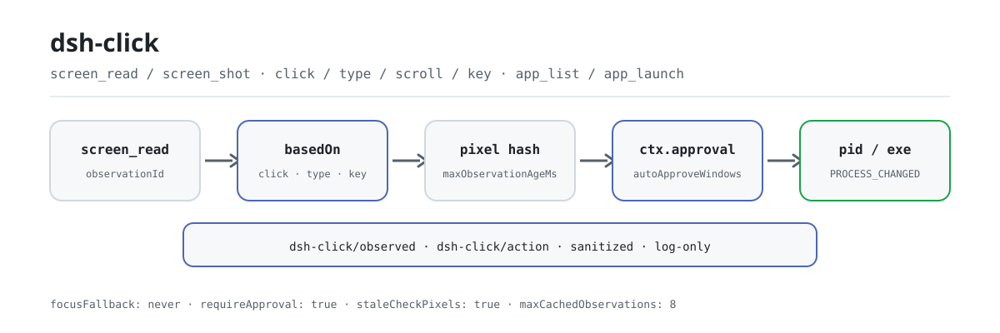

<div align="center">

<picture>
  <source media="(prefers-color-scheme: dark)" srcset="docs/assets/dsh-click-flow-dark.svg">
  
</picture>

# dsh-click

**See the screen, then act — every mutating click is gated, every observation and action is audited.**

Native desktop control for DeepSeek Harness (Windows first): an accessibility tree plus pixel hints let text-only models “see”, window-scoped click and input let them “act”, and approval, freshness, and process-identity checks sit in between.

[Install](#three-step-setup) · [Configuration](#configuration) · [FAQ](#faq) · [简体中文](README.md) · [English](README.en.md) · [Español](README.es.md) · [Português](README.pt.md) · [हिन्दी](README.hi.md)

[](LICENSE)
[](#compatibility)
[](https://www.npmjs.com/package/dsh-click)
[](https://github.com/PerryLink/dsh-click/actions/workflows/ci.yml)
[](#compatibility)

[](https://github.com/PerryLink/dsh-click/stargazers)
[](https://www.npmjs.com/package/dsh-click)
[](https://dshfind.com/plugins/PerryLink/dsh-click?ref=badge)
[](https://securityscorecards.dev/viewer/?uri=github.com/PerryLink/dsh-click)
[](https://dsh.market/)
[](https://gitee.com/perrylink/dsh-click)

```sh
dsh plugin --profile <name> add dsh-click
```

</div>

<sub>Community plugin, not affiliated with DeepSeek. Canonical repository: <https://github.com/PerryLink/dsh-click> (Gitee is a mirror).</sub>

## What it is

`dsh-click` gives the model a complete observe → act loop: `screen_read` returns a window’s accessibility tree (element ids, types, names, rectangles, supported patterns) plus pixel-location hints, or `screen_shot` captures an image; then `click` / `type` / `scroll` / `key` act on that same window by element id or coordinates. Every mutating action must cite a fresh observation (`basedOn`) — a changed screen or an expired observation is refused with a model-readable reason — and crosses `ctx.approval` by default, with the target process identity verified before and after. It does not steal foreground focus by default (`focusFallback: never`), and every observation and action lands as a sanitized `dsh-click/observed` / `dsh-click/action` audit event.

## Three-step setup

1. **Install** (pick one channel):

   ```sh
   # git channel (latest main; equivalent to git+https://github.com/PerryLink/dsh-click.git)
   dsh plugin --profile web add github:PerryLink/dsh-click
   # npm channel (published releases)
   dsh plugin --profile web add dsh-click
   # tarball channel: pnpm pack in this repo, then
   dsh plugin --profile web add ./dsh-click-<version>.tgz
   ```

   The git channel’s `prepare` script builds with production dependencies only.

2. **Minimal config** (sane defaults; touch `autoApproveWindows` only to exempt specific windows):

   ```yaml
   - insert:
       - id: dsh-click
         name: dsh-click
         config:
           requireApproval: true
           autoApproveWindows: ['^Notepad']
           focusFallback: never
   ```

3. **Verify it mounts** (after a restart):

   ```sh
   dsh --profile web --dump-config | grep -A3 'id: dsh-click'
   ```

   Then ask the agent to look at a window and act — the approval prompt appears for every mutating action:

   ```text
   > Open Notepad, type "hello", then read back what is on screen.
   ```

**Uninstall**: `dsh plugin --profile web remove dsh-click` (or remove the row from the profile patch).

> If pnpm reports `ERR_PNPM_IGNORED_BUILDS` for this package (esbuild’s harmless platform-binary validation), add `allowBuilds: { esbuild: true }` to your `pnpm-workspace.yaml` — the `dsh` CLI prints the exact snippet.

<details>
<summary>Install from the DSH Desktop market</summary>

Every PerryLink plugin is listed in the built-in DSH Desktop market: **Market → Sources → Add source → paste** `https://perrylink-dsh-catalog.perrylink.workers.dev/catalog-source.json` **→ select**. Installation still requires the market’s npm identity check and your confirmation.

</details>

## Core capabilities

`dsh-click` splits the native desktop into an auditable observation face and action face:

- **`screen_shot`** — captures a window (or the primary screen) and downscales it to `maxScreenshotSide`. With a vision-capable model the result carries the image; text-only models get a text description and keep working.
- **`screen_read`** — the structured observation: the accessibility tree (element ids, types, names, rectangles, supported patterns) plus pixel-location hints with colors — plain text, no image model required.
- **`screen_find`** — for applications that expose no accessibility tree, finds clickable text or a described visual target via optional OCR (`ocr.*`, tesseract probed at mount) or visual grounding, returning screen coordinates plus an `observationId`; read-only, never needs approval.
- **`click` / `type` / `scroll` / `key`** — window-scoped actions addressed by element id or coordinates. Delivery prefers UIA invoke, falls back to posted window messages, and never steals foreground focus by default; `type` takes the UIA `ValuePattern` fast path and otherwise injects real keystrokes through `SendInput` (CJK-safe); `key` reports honestly when an app ignores posted input.
- **`app_list` / `app_launch`** — enumerate running applications and their visible windows; launch one by name or executable path.

Every mutating action crosses one shared safety boundary:

1. **Freshness** — the action must cite a `basedOn` observation; the window is re-captured right before acting, and the action is refused when the pixel hash (`staleCheckPixels`) or the accessibility tree (`staleCheckTree`) changed, or when the observation is older than `maxObservationAgeMs`.
2. **Approval** — `ctx.approval` gates every action by default; `autoApproveWindows` title/executable regexes can exempt specific windows (still freshness-checked, process-verified, and audited).
3. **Process identity** — the owning process’s pid and executable path are verified before **and** after the act; a mid-act swap refuses loudly (`PROCESS_CHANGED`).
4. **Audit** — observations and actions land in the session log as `dsh-click/observed` / `dsh-click/action` events (sanitized, log-only).

```text
model                           harness
  │ screen_read ──▶ observationId (+ elements, pixels)         ← structured text
  │ click {basedOn, target} ──▶ freshness check ──▶ approval ──▶ helper (UIA)
  │                             pixel hash changed? ── refuse + re-observe
  │                             pid/exe changed after act? ── PROCESS_CHANGED
  │ ◀── canonical JSON + audit events (dsh-click/action)
```

### Tool surface

| Tool | Read-only | Needs approval | Notes |
|---|---|---|---|
| `screen_shot` | ✅ | — | Returns an `observationId` later actions cite in `basedOn`; image attachment when the model accepts images |
| `screen_read` | ✅ | — | Accessibility tree + pixel hints; element ids are what actions address |
| `screen_find` | ✅ | — | OCR/visual grounding when there is no UIA tree; returns coordinate targets + an `observationId` |
| `click` | | ✅ | Exactly one of `elementId` or `(x, y)`; UIA invoke preferred, posted messages fallback |
| `type` | | ✅ | Value-pattern elements only; backs up and restores control text on failure |
| `scroll` | | ✅ | Element (scroll pattern) or window (posted wheel) |
| `key` | | ✅ | Posted key combinations (`"Ctrl+S"`); apps that ignore posted input refuse loudly |
| `app_list` | ✅ | — | Running applications and their visible windows |
| `app_launch` | | ✅ | By name or executable path, with optional arguments |

### Examples

These are the plugin’s real entry points; install once, then call one.

**Detailed example** — command `app_list`, input:

```json
{}
```

Output:

```text
1 running application(s) with windows:
- Demo (pid 4242, C:\Apps\demo.exe)
  - [windowId 1122867] "Demo App" at (10, 20) 800x600
```

*Observed from `plugins/dsh-click/tests/tools.spec.ts:159-185; renderer at src/tools.ts:933-942`*

**Failure branch** — input:

```text
{}
```

Output:

```text
Error: dsh-click backend unavailable on linux: Linux backend is reserved but not implemented yet (Windows-first); only Windows can act today
```

*Observed from `plugins/dsh-click/src/platform/selection.ts:61-62,81; plugins/dsh-click/src/tools.ts:133-136; plugins/dsh-click/tests/tools.spec.ts:226-245`*

**Brief examples**: `screen_read` · `app_list`

## Configuration

All tunables are Schemastery `Config` fields (changeable from cordis.yml). An id-targeted override replaces the whole row — restate every key you need. `cordis.patch.yml` documents each key inline.

Most-used keys:

| Key | Default | Meaning |
|---|---|---|
| `requireApproval` | `true` | Gate every mutating action behind approval; observers never ask |
| `autoApproveWindows` | `[]` | Window-title/executable regexes that skip the approval ask (still freshness-checked, process-verified, and audited) |
| `focusFallback` | `never` | Whether an action may bring the target window to the foreground as a last resort (`never` / `allow`) |
| `imageMode` | `auto` | `screen_shot` rendering: `auto` (image when the model accepts images, text otherwise) or `text` |
| `staleCheckPixels` | `true` | Compare a fresh pixel hash before every action and refuse on change |
| `staleCheckTree` | `target` | Accessibility-tree freshness: `target` verifies the addressed element (default), `strict` refuses any changed node, `off` skips the tree hash (identity/age/pixel checks still apply) |
| `maxObservationAgeMs` | `30000` | Maximum age in ms of an observation an action may cite (1000..600000) |
| `auditSessionEvents` | `true` | Whether to append `dsh-click/observed` / `dsh-click/action` audit events; set `false` to stop audit appends entirely |

<details>
<summary>Full configuration table (17 rows)</summary>

| Key | Default | Meaning |
|---|---|---|
| `requireApproval` | `true` | Gate every mutating action behind approval; observers never ask |
| `autoApproveWindows` | `[]` | Window-title/executable regexes that skip the approval ask (still freshness-checked, process-verified, and audited) |
| `auditSessionEvents` | `true` | Append `dsh-click/observed` / `dsh-click/action` session audit events. The adaptive gate already skips the append on envelope-less hosts (rc.6–rc.8, 0.1.1-rc.2, and 0.1.2-rc.1, which fails closed on unknown types at read); set `false` to stop audit appends entirely. `0.1.2-rc.1` (adapted 2026-09-02): the session envelope keeps its ignorable field for stored-log read compatibility only — `Session.append` still cannot stamp it, so audit-gate behavior is unchanged |
| `focusFallback` | `never` | Whether an action may bring the target window to the foreground as a last resort (`never` / `allow`) |
| `imageMode` | `auto` | `screen_shot` rendering: `auto` (image when the model accepts images, text otherwise) or `text` |
| `helperTimeoutMs` | `30000` | Per-helper-call timeout in ms (1..300000) |
| `maxHelperOutputBytes` | `25165824` | Cap on one helper response in bytes (1024..67108864) |
| `maxScreenshotSide` | `2560` | Longest screenshot side in pixels (320..7680); larger captures are downscaled |
| `staleCheckPixels` | `true` | Compare a fresh pixel hash before every action and refuse on change |
| `staleCheckTree` | `target` | Accessibility-tree freshness: `target` verifies the addressed element (default), `strict` refuses any changed node, `off` skips the whole-tree hash for windows with a ticking clock/cursor (identity/age/pixel checks still apply) |
| `maxObservationAgeMs` | `30000` | Maximum age in ms of an observation an action may cite (1000..600000) |
| `maxCachedObservations` | `8` | LRU cap on cached observations (1..64) |
| `maxElements` | `500` | Cap on accessibility elements per `screen_read` (1..2000) |
| `maxTreeDepth` | `32` | Maximum accessibility tree-walk depth (1..64) |
| `maxTextLength` | `200` | Truncation length for sanitized model-visible strings (16..10000) |
| `rollbackEnabled` | `true` | Back up and restore control text when `type` fails |
| `ocr.enabled` / `command` / `language` | `true` / `tesseract` / `eng` | Optional OCR for the `screen_find` path (probed at mount; degrades to unavailable when tesseract is absent) |

</details>

Example override in your profile patch:

```yaml
- insert:
    - id: dsh-click
      name: dsh-click
      config:
        requireApproval: true
        autoApproveWindows: ['^Notepad']
        focusFallback: never
```

## FAQ

<details>
<summary>Where do screenshots and observations live? Can screen content hit the disk?</summary>

A `screen_shot` image goes into the harness attachment store (content-addressed, under the host’s own attachment policy) and is provided to the model only through that tool result. Observations themselves stay in memory (bounded LRU, `maxCachedObservations`, lost on restart); beyond that the plugin writes nothing to disk, makes no network requests, and stores no credentials. The only session-log content is the `dsh-click/*` audit events, and window titles, executable paths, and free text are sanitized and length-capped before they are written or shown.

</details>

<details>
<summary>What happens on macOS / Linux? Silent breakage?</summary>

Nothing is silent. Both backends are reserved but unimplemented, so every call fails closed with a model-readable reason (`dsh-click backend unavailable on linux: ...`), and the profile still boots everywhere. On Windows, a missing `subprocess` service or an unavailable helper refuses the call loudly instead of pretending success.

</details>

<details>
<summary>Does it fight other plugins over commands, services, or slots?</summary>

It provides no service key and consumes only two optional seams (`dsh-click/backend`, `dsh-click/grounding`, for tests/embeddings); it registers no client slot, no `webServer` route, and no waterfall listener; every audit event sits in the `dsh-click/*` namespace. Each tool registration is wrapped in `ctx.effect`, so stop/hot-reload removes exactly the tools it registered.

</details>

<details>
<summary>How big is the performance overhead? Does every action re-capture the screen?</summary>

Observations are produced on demand: `screen_read` only walks the accessibility tree (plain text), while `screen_shot` encodes a PNG. Every mutating action re-captures the target window once for the freshness comparison (pixel hash plus tree by default) — that is part of the safety boundary. Helper calls are bounded by `helperTimeoutMs` / `maxHelperOutputBytes`, and the observation cache keeps 8 entries by default.

</details>

## Security boundaries

- **Observe before act, every time.** Actions must cite a fresh observation; a changed screen (pixel hash) or an expired observation is refused with a model-readable reason demanding re-observation.
- **Approval is the default.** `requireApproval: true` unless you explicitly exempt specific windows; every action — allowed or not — is audit-logged.
- **No foreground stealing.** The helper never brings a target window to the foreground (`focusFallback: 'never'` by default); input is delivered through UIA or posted messages so background windows are not disturbed. `focusFallback: 'allow'` is the only sanctioned exception.
- **Process identity is re-verified** immediately before and after each action; a mid-act process swap fails the outcome (`PROCESS_CHANGED`).
- **Sanitized output.** Control characters are stripped, tabs collapse, credential-shaped values (keys, tokens, JWTs, bearer headers) are redacted before anything reaches the model or the log.
- **Fail closed.** Unsupported platforms, a missing subprocess service, or an unavailable helper refuse every call loudly — profiles keep booting everywhere.

## Permissions & data

- **Permissions**: mutating actions cross the official `ctx.approval` seam — the plugin never re-implements or bypasses it. `autoApproveWindows` only ever *skips the ask for specific windows*; it cannot disable the freshness or process-identity checks. The `dshWorkshop` manifest declares `fs:read`, `subprocess:spawn`, `session:append`, `network:none`, `native-code:none`.
- **Data**: the plugin stores nothing on disk except the screenshots the attachment store keeps (content-addressed, under the harness’s own attachment policy). Observations are cached in memory (LRU, bounded). No network requests, no credential storage.
- **Session log**: `dsh-click/observed` and `dsh-click/action` are log-only audit events carrying sanitized window/process facts — titles, paths, and free text are redacted and length-capped before they are written or shown.

## Known limitations

- **Windows first.** macOS and Linux backends are reserved; on those platforms every call fails closed with a clear reason.
- **Text-only fidelity.** `screen_read` depends on the application exposing UIAutomation; apps without an accessible tree yield pixel hints only, plus the `screen_find` OCR/grounding path. Coordinate clicks remain available.
- **Posted-input apps.** Some applications ignore posted window messages (games, some Electron surfaces); `key` reports this honestly instead of pretending success. Since 0.3.24 the `type` `SendInput` fallback covers real keyboard input and CJK text, but it is still bounded by the target app’s own input model.
- **Session audit on envelope-less harness builds.** The audit events ride an adaptive gate: hosts that know the vocabulary append plainly, hosts with the `ignorable` envelope append with the marker, and envelope-less hosts — `0.1.0-rc.6`–`0.1.0-rc.8`, `0.1.1-rc.2`, and `0.1.2-rc.1` (which cannot stamp the ignorable marker — the envelope field is retained for stored-log read compatibility only — and fails closed on unknown types at read) — get no audit append; the tool results remain the reconstructable audit trail. Set `auditSessionEvents: false` to stop audit appends entirely.

## Interoperability with other DSH plugins

`dsh-click` exposes a tool surface only and does not join other plugins’ seams:

- **Two hard services only.** `inject = ['tools', 'subprocess']`; it provides no service key, so it cannot collide on one.
- **No client or HTTP resources.** It registers no client slot, no `webServer` route, and no `agent/pre-step` / `tools/post-execute` waterfall listener, and mutates no globals.
- **Namespaced audit.** It writes only `dsh-click/observed` and `dsh-click/action`; when a host does not know the vocabulary the adaptive gate skips them, and the tool results remain the reconstructable audit trail.
- **Optional seams degrade.** `dsh-click/backend` and `dsh-click/grounding` exist for tests/embeddings only; real deployments fall through to platform selection and require no other plugin.
- **Registrations are effects.** Every `ctx.tools.register` is wrapped in `ctx.effect`, so stop/hot-reload removes exactly the tools it registered.

## Compatibility

| Surface | Status |
|---|---|
| Harness | DeepSeek Harness `dsh-v0.2.1-alpha.1` (GitHub tag, verified 2026-09-25). Verified 2026-09-11 against the `dsh-v0.1.7-alpha.1` master checkout (full gate chain + profile install smoke). `engines.dsh`: `>=0.2.1-0 <0.3.0 \|\| >=0.2.2-0 <0.3.0` |
| Node | `^22.19.0 \|\| >=24.9.0` |
| Platforms | **Windows first** (UIAutomation + Win32 input, via a bundled PowerShell helper); macOS/Linux backends are reserved and fail closed with a clear reason |
| Model | Text-only models fully supported (`screen_read` returns structured text); vision models additionally get `screen_shot` images |

## Ecosystem & quality

- [Gitee mirror](https://gitee.com/perrylink/dsh-click) (sync mirror; GitHub is canonical)
- [dshfind plugin page](https://dshfind.com/plugins/PerryLink/dsh-click) (installs and ranking)
- [OpenSSF Scorecard report](https://securityscorecards.dev/viewer/?uri=github.com/PerryLink/dsh-click) (driven by [.github/workflows/scorecard.yml](.github/workflows/scorecard.yml))
- [dsh-plugin-doctor verification report](https://github.com/PerryLink/dsh-plugin-doctor#verified-徽章) (K10–K13 all `pass`)
- [DSH Market](https://dsh.market/) (listed)
- **1024 store channel**: `npm i -g dsh1024` once, then `dsh1024 plugin --profile web add dsh-click` (counts toward the [deepseek1024.com](https://deepseek1024.com) install ranking)
- [Ecosystem knowledge base](https://perrylink.github.io/dsh-plugin-guide/) — measured data, not marketing: plugin development guide · plugin-selection data · maintenance criteria

## Development

```sh
pnpm install        # node ^22.19 || >=24
pnpm run typecheck  # tsc: src + tests against the local harness checkout
pnpm run typecheck:ci  # tsc against the published host types (no paths)
pnpm test           # vitest: 79 tests, 13 files (helper smoke runs on Windows)
pnpm run build      # tsdown bundle + tsc declarations (lib/)
pnpm run verify:self-contained  # dependency specs resolve from the registry
pnpm run verify:artifacts       # built ESM face + native helper present
pnpm run check:readmes          # five-language README consistency
pnpm pack           # the published tarball
```

The README images are generated programmatically by [`scripts/gen-readme-assets.py`](scripts/gen-readme-assets.py) (Python + Pillow) and are safe to re-run: `python scripts/gen-readme-assets.py`.

Topics: `dsh`, `dsh-plugin`, `deepseek-harness`, `deepseek`, `cordis`, `computer-use`, `windows-automation`, `uiautomation`, `desktop-control`, `screen-reader`

## Family & thanks

This project is part of the DeepSeek Harness plugin family from [PerryLink](https://github.com/PerryLink) (all Apache-2.0). If it is useful, **a star helps the next person find it** — nothing is gated behind it.

- [Windows helper smoke checklist](docs/windows-smoke.md) — real input/focus verification for 0.3.24+.
- [@LIU12312-Source](https://github.com/LIU12312-Source) — real `SendInput`/foreground-focus fallback for the Windows helper (PR #21).
- [@Mchsd](https://github.com/Mchsd) — added the `auditSessionEvents` opt-out for harnesses whose session reader rejects the `dsh-click` audit events (#2).
- [@PerryLink](https://github.com/PerryLink) — creator and maintainer: tool surface, action safety boundary, Windows native helper, sanitizers, and the five-language docs.

<details>
<summary>Expand all plugins</summary>

| Plugin | Status |
|---|---|
| **[dsh-aqua-input-check](https://github.com/PerryLink/dsh-aqua-input-check)** |  |
| **[dsh-archive-check](https://github.com/PerryLink/dsh-archive-check)** |  |
| **[dsh-auto-review](https://github.com/PerryLink/dsh-auto-review)** |  |
| **[dsh-autotier](https://github.com/PerryLink/dsh-autotier)** | 🧊 FROZEN — see the repo README |
| **[dsh-bid-ca-precheck](https://github.com/PerryLink/dsh-bid-ca-precheck)** |  |
| **[dsh-bid-qual-check](https://github.com/PerryLink/dsh-bid-qual-check)** |  |
| **[dsh-cert-mcp](https://github.com/PerryLink/dsh-cert-mcp)** | 🧊 FROZEN — see the repo README |
| **[dsh-checkpoint-rewind](https://github.com/PerryLink/dsh-checkpoint-rewind)** |  |
| **[dsh-click](https://github.com/PerryLink/dsh-click)** |  |
| **[dsh-composer-history](https://github.com/PerryLink/dsh-composer-history)** |  |
| **[dsh-contract-stance](https://github.com/PerryLink/dsh-contract-stance)** |  |
| **[dsh-customs-doc-check](https://github.com/PerryLink/dsh-customs-doc-check)** |  |
| **[dsh-data-quality](https://github.com/PerryLink/dsh-data-quality)** | 🧊 FROZEN — see the repo README |
| **[dsh-demurrage-ledger](https://github.com/PerryLink/dsh-demurrage-ledger)** |  |
| **[dsh-doublecheck](https://github.com/PerryLink/dsh-doublecheck)** |  |
| **[dsh-drill-script-check](https://github.com/PerryLink/dsh-drill-script-check)** |  |
| **[dsh-eia-guide-check](https://github.com/PerryLink/dsh-eia-guide-check)** |  |
| **[dsh-emergency-plan](https://github.com/PerryLink/dsh-emergency-plan)** |  |
| **[dsh-essay-rubric-check](https://github.com/PerryLink/dsh-essay-rubric-check)** |  |
| **[dsh-evidence-check](https://github.com/PerryLink/dsh-evidence-check)** |  |
| **[dsh-export-ctl-check](https://github.com/PerryLink/dsh-export-ctl-check)** |  |
| **[dsh-fast](https://github.com/PerryLink/dsh-fast)** |  |
| **[dsh-fmea-table-check](https://github.com/PerryLink/dsh-fmea-table-check)** |  |
| **[dsh-forecast-penalty](https://github.com/PerryLink/dsh-forecast-penalty)** |  |
| **[dsh-fund-research](https://github.com/PerryLink/dsh-fund-research)** |  |
| **[dsh-github](https://github.com/PerryLink/dsh-github)** |  |
| **[dsh-gongwen-flow-check](https://github.com/PerryLink/dsh-gongwen-flow-check)** |  |
| **[dsh-gongwen-word-check](https://github.com/PerryLink/dsh-gongwen-word-check)** |  |
| **[dsh-guard-plan-qc](https://github.com/PerryLink/dsh-guard-plan-qc)** |  |
| **[dsh-hazchem-check](https://github.com/PerryLink/dsh-hazchem-check)** |  |
| **[dsh-hazplan-check](https://github.com/PerryLink/dsh-hazplan-check)** |  |
| **[dsh-hidden-risk-map](https://github.com/PerryLink/dsh-hidden-risk-map)** |  |
| **[dsh-hs-classify](https://github.com/PerryLink/dsh-hs-classify)** |  |
| **[dsh-icd-rule-check](https://github.com/PerryLink/dsh-icd-rule-check)** |  |
| **[dsh-industry-research](https://github.com/PerryLink/dsh-industry-research)** |  |
| **[dsh-lawcite-adapter](https://github.com/PerryLink/dsh-lawcite-adapter)** |  |
| **[dsh-laya](https://github.com/PerryLink/dsh-laya)** |  |
| **[dsh-lc-doc-check](https://github.com/PerryLink/dsh-lc-doc-check)** |  |
| **[dsh-learning-gap-check](https://github.com/PerryLink/dsh-learning-gap-check)** |  |
| **[dsh-library](https://github.com/PerryLink/dsh-library)** |  |
| **[dsh-local-ai](https://github.com/PerryLink/dsh-local-ai)** |  |
| **[dsh-lsp-actions](https://github.com/PerryLink/dsh-lsp-actions)** |  |
| **[dsh-mask](https://github.com/PerryLink/dsh-mask)** |  |
| **[dsh-mcp-panel](https://github.com/PerryLink/dsh-mcp-panel)** |  |
| **[dsh-medrec-qc](https://github.com/PerryLink/dsh-medrec-qc)** |  |
| **[dsh-memento](https://github.com/PerryLink/dsh-memento)** | 🧊 FROZEN — see the repo README |
| **[dsh-nsfc-form-check](https://github.com/PerryLink/dsh-nsfc-form-check)** |  |
| **[dsh-nurse-record-check](https://github.com/PerryLink/dsh-nurse-record-check)** |  |
| **[dsh-observe](https://github.com/PerryLink/dsh-observe)** |  |
| **[dsh-origin-rvc-check](https://github.com/PerryLink/dsh-origin-rvc-check)** |  |
| **[dsh-ota-review-check](https://github.com/PerryLink/dsh-ota-review-check)** |  |
| **[dsh-output-styles](https://github.com/PerryLink/dsh-output-styles)** |  |
| **[dsh-paper-doc-adapter](https://github.com/PerryLink/dsh-paper-doc-adapter)** |  |
| **[dsh-permission-rules](https://github.com/PerryLink/dsh-permission-rules)** |  |
| **[dsh-permit-report-check](https://github.com/PerryLink/dsh-permit-report-check)** |  |
| **[dsh-pipeline-check](https://github.com/PerryLink/dsh-pipeline-check)** |  |
| **[dsh-pleading-draft](https://github.com/PerryLink/dsh-pleading-draft)** |  |
| **[dsh-plugin-doctor](https://github.com/PerryLink/dsh-plugin-doctor)** | 🚫 RETIRED (repo archived) |
| **[dsh-plugin-guide](https://github.com/PerryLink/dsh-plugin-guide)** |  |
| **[dsh-plugin-kit](https://github.com/PerryLink/dsh-plugin-kit)** | 🚫 RETIRED (repo archived) |
| **[dsh-plugin-upgrade](https://github.com/PerryLink/dsh-plugin-upgrade)** | 🚫 RETIRED (repo archived) |
| **[dsh-policy-brief-draft](https://github.com/PerryLink/dsh-policy-brief-draft)** |  |
| **[dsh-power-loss-split](https://github.com/PerryLink/dsh-power-loss-split)** |  |
| **[dsh-power-ticket-check](https://github.com/PerryLink/dsh-power-ticket-check)** |  |
| **[dsh-ppap-check](https://github.com/PerryLink/dsh-ppap-check)** |  |
| **[dsh-protest-deadline](https://github.com/PerryLink/dsh-protest-deadline)** |  |
| **[dsh-railway-window](https://github.com/PerryLink/dsh-railway-window)** |  |
| **[dsh-repair-order-qc](https://github.com/PerryLink/dsh-repair-order-qc)** |  |
| **[dsh-research-report](https://github.com/PerryLink/dsh-research-report)** |  |
| **[dsh-review-reply-check](https://github.com/PerryLink/dsh-review-reply-check)** |  |
| **[dsh-rulefile-check](https://github.com/PerryLink/dsh-rulefile-check)** |  |
| **[dsh-safety-brief-check](https://github.com/PerryLink/dsh-safety-brief-check)** |  |
| **[dsh-score](https://github.com/PerryLink/dsh-score)** | 🧊 FROZEN — see the repo README |
| **[dsh-session-sync](https://github.com/PerryLink/dsh-session-sync)** |  |
| **[dsh-site-log-check](https://github.com/PerryLink/dsh-site-log-check)** |  |
| **[dsh-skill-pack-security](https://github.com/PerryLink/dsh-skill-pack-security)** |  |
| **[dsh-soe-decision-check](https://github.com/PerryLink/dsh-soe-decision-check)** |  |
| **[dsh-soilwater-check](https://github.com/PerryLink/dsh-soilwater-check)** |  |
| **[dsh-sop-sync-check](https://github.com/PerryLink/dsh-sop-sync-check)** |  |
| **[dsh-spc-gbt-adapter](https://github.com/PerryLink/dsh-spc-gbt-adapter)** |  |
| **[dsh-talk](https://github.com/PerryLink/dsh-talk)** |  |
| **[dsh-tender-extract](https://github.com/PerryLink/dsh-tender-extract)** |  |
| **[dsh-tender-matrix](https://github.com/PerryLink/dsh-tender-matrix)** |  |
| **[dsh-test-drive](https://github.com/PerryLink/dsh-test-drive)** |  |
| **[dsh-ticktick](https://github.com/PerryLink/dsh-ticktick)** | 🚫 RETIRED (repo archived) |
| **[dsh-translate](https://github.com/PerryLink/dsh-translate)** |  |
| **[dsh-warranty-calc](https://github.com/PerryLink/dsh-warranty-calc)** |  |
| **[dsh-budget](https://github.com/PerryLink/dsh-budget)** | 🧊 FROZEN — see the repo README |
| **[dsh-claude-move](https://github.com/PerryLink/dsh-claude-move)** | 🧊 FROZEN — see the repo README |
| **[dsh-defend](https://github.com/PerryLink/dsh-defend)** | 🧊 FROZEN — see the repo README |
| **[dsh-draw](https://github.com/PerryLink/dsh-draw)** | 🧊 FROZEN — see the repo README |
| **[dsh-reach](https://github.com/PerryLink/dsh-reach)** | 🧊 FROZEN — see the repo README |
| **[dsh-background-agents](https://github.com/PerryLink/dsh-background-agents)** | 🚫 RETIRED (repo archived) |
| **[dsh-session-pin](https://github.com/PerryLink/dsh-session-pin)** | 🚫 RETIRED (repo archived) |
| **[dsh-team-rooms](https://github.com/PerryLink/dsh-team-rooms)** | 🚫 RETIRED (repo archived) |

</details>

## License

[LICENSE](LICENSE) (Apache License 2.0) © 2026 dsh-click contributors

<p align="center"><sub>Apache-2.0 · Community plugin, not affiliated with DeepSeek.</sub></p>
