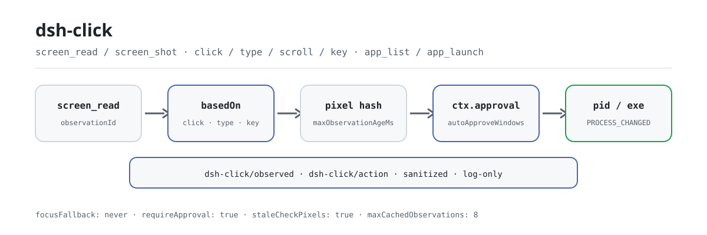

<div align="center">

<picture>
  <source media="(prefers-color-scheme: dark)" srcset="docs/assets/dsh-click-flow-dark.svg">
  
</picture>

# dsh-click

**Ver la pantalla y luego actuar: cada clic se autoriza y cada observación y acción queda auditada.**

Control nativo del escritorio para DeepSeek Harness (Windows primero): el árbol de accesibilidad y las pistas de píxeles permiten que un modelo de solo texto «vea», el clic y la entrada con ámbito de ventana le permiten «actuar», y la aprobación, la frescura y la identidad del proceso quedan en medio.

[Instalar](#instalación-en-tres-pasos) · [Configuración](#configuración) · [FAQ](#faq) · [简体中文](README.md) · [English](README.en.md) · [Español](README.es.md) · [Português](README.pt.md) · [हिन्दी](README.hi.md)

[](LICENSE)
[](#compatibilidad)
[](https://www.npmjs.com/package/dsh-click)
[](https://github.com/PerryLink/dsh-click/actions/workflows/ci.yml)
[](#compatibilidad)

[](https://github.com/PerryLink/dsh-click/stargazers)
[](https://www.npmjs.com/package/dsh-click)
[](https://dshfind.com/plugins/PerryLink/dsh-click?ref=badge)
[](https://securityscorecards.dev/viewer/?uri=github.com/PerryLink/dsh-click)
[](https://dsh.market/)
[](https://gitee.com/perrylink/dsh-click)

```sh
dsh plugin --profile <name> add dsh-click
```

</div>

<sub>Plugin de la comunidad, no afiliado a DeepSeek. Repositorio canónico: <https://github.com/PerryLink/dsh-click> (Gitee es un espejo).</sub>

## Qué es

`dsh-click` da al modelo un bucle completo de observar → actuar: `screen_read` lee el árbol de accesibilidad de una ventana (ids de elemento, tipos, nombres, rectángulos, patrones soportados) más pistas de posición y color, o `screen_shot` captura una imagen; después `click` / `type` / `scroll` / `key` actúan sobre esa misma ventana por id de elemento o por coordenadas. Cada acción mutante debe citar una observación fresca (`basedOn`): si la pantalla cambió o la observación caducó, se rechaza con una razón legible para el modelo; además pasa por `ctx.approval` por defecto y la identidad del proceso destino se verifica antes y después. No roba el foco de primer plano por defecto (`focusFallback: never`), y cada observación y acción queda como evento de auditoría `dsh-click/observed` / `dsh-click/action` ya saneado.

## Instalación en tres pasos

1. **Instala** (elige un canal):

   ```sh
   # canal git (último main; equivalente a git+https://github.com/PerryLink/dsh-click.git)
   dsh plugin --profile web add github:PerryLink/dsh-click
   # canal npm (versiones publicadas)
   dsh plugin --profile web add dsh-click
   # canal tarball: pnpm pack en este repo y luego
   dsh plugin --profile web add ./dsh-click-<version>.tgz
   ```

   El script `prepare` del canal git compila solo con dependencias de producción.

2. **Configuración mínima** (los valores por defecto ya funcionan; toca `autoApproveWindows` solo para eximir ventanas concretas):

   ```yaml
   - insert:
       - id: dsh-click
         name: dsh-click
         config:
           requireApproval: true
           autoApproveWindows: ['^Notepad']
           focusFallback: never
   ```

3. **Verifica que se monta** (tras reiniciar):

   ```sh
   dsh --profile web --dump-config | grep -A3 'id: dsh-click'
   ```

   Luego pide al agente que mire una ventana y actúe: el aviso de aprobación aparece para cada acción mutante:

   ```text
   > Abre el Bloc de notas, escribe "hello" y vuelve a leer lo que hay en pantalla.
   ```

**Desinstalar**: `dsh plugin --profile web remove dsh-click` (o elimina la fila del patch del perfil).

> Si pnpm informa `ERR_PNPM_IGNORED_BUILDS` para este paquete (la validación inofensiva del binario de plataforma de esbuild), añade `allowBuilds: { esbuild: true }` a tu `pnpm-workspace.yaml`; la CLI de `dsh` imprime el fragmento exacto.

<details>
<summary>Instalar desde el mercado de DSH Desktop</summary>

Todos los plugins de PerryLink pueden explorarse en el mercado integrado de DSH Desktop: **Market → Sources → add source → pegar** `https://perrylink-dsh-catalog.perrylink.workers.dev/catalog-source.json` **→ seleccionarlo**. La instalación sigue pasando por la verificación de identidad npm del mercado y tu confirmación.

</details>

## Capacidades clave

`dsh-click` separa el escritorio nativo en una cara de observación y otra de acción, ambas auditables:

- **`screen_shot`** — captura una ventana (o la pantalla principal) y la escala a `maxScreenshotSide`. Con un modelo capaz de ver imágenes el resultado lleva la imagen; los modelos de solo texto reciben una descripción textual y siguen funcionando.
- **`screen_read`** — la observación estructurada: el árbol de accesibilidad (ids de elemento, tipos, nombres, rectángulos, patrones soportados) más pistas de posición de píxeles con colores; texto plano, sin necesidad de modelo de imagen.
- **`screen_find`** — para aplicaciones sin árbol de accesibilidad, busca texto clicable o un objetivo visual descrito mediante OCR opcional (`ocr.*`, tesseract sondeado al montar) o grounding visual, y devuelve coordenadas de pantalla más un `observationId`; es de solo lectura y nunca pide aprobación.
- **`click` / `type` / `scroll` / `key`** — acciones con ámbito de ventana direccionadas por id de elemento o coordenadas. La entrega prefiere la invocación UIA y recurre a mensajes de ventana publicados, y por defecto nunca roba el foco de primer plano; `type` usa la vía rápida `ValuePattern` de UIA y, si falla, inyecta pulsaciones reales con `SendInput` (seguro para CJK); `key` informa con honestidad cuando una app ignora la entrada publicada.
- **`app_list` / `app_launch`** — enumera las aplicaciones en ejecución y sus ventanas visibles; lanza una por nombre o ruta del ejecutable.

Toda acción mutante cruza la misma frontera de seguridad:

1. **Frescura** — la acción debe citar una observación `basedOn`; la ventana se vuelve a capturar justo antes de actuar y la acción se rechaza si cambió el hash de píxeles (`staleCheckPixels`) o el árbol (`staleCheckTree`), o si la observación supera `maxObservationAgeMs`.
2. **Aprobación** — `ctx.approval` controla cada acción por defecto; los regex de título/ejecutable de `autoApproveWindows` pueden eximir ventanas concretas (siguen pasando frescura, identidad de proceso y auditoría).
3. **Identidad del proceso** — el pid y la ruta del ejecutable propietario se verifican antes **y** después de actuar; un cambio a mitad de la acción la falla en voz alta (`PROCESS_CHANGED`).
4. **Auditoría** — observaciones y acciones quedan en el registro de sesión como eventos `dsh-click/observed` / `dsh-click/action` (saneados, solo registro).

```text
modelo                          harness
  │ screen_read ──▶ observationId (+ elementos, píxeles)      ← texto estructurado
  │ click {basedOn, target} ──▶ chequeo de frescura ──▶ aprobación ──▶ helper (UIA)
  │                             ¿hash de píxeles cambió? ── rechaza + re-observa
  │                             ¿pid/exe cambió tras actuar? ── PROCESS_CHANGED
  │ ◀── JSON canónico + eventos de auditoría (dsh-click/action)
```

### Superficie de herramientas

| Herramienta | Solo lectura | Requiere aprobación | Notas |
|---|---|---|---|
| `screen_shot` | ✅ | — | Devuelve un `observationId` que las acciones posteriores citan en `basedOn`; adjunta imagen cuando el modelo acepta imágenes |
| `screen_read` | ✅ | — | Árbol de accesibilidad + pistas de píxeles; los ids de elemento son la dirección de las acciones |
| `screen_find` | ✅ | — | OCR/grounding visual cuando no hay árbol UIA; devuelve objetivos por coordenadas + un `observationId` |
| `click` | | ✅ | Exactamente uno de `elementId` o `(x, y)`; se prefiere UIA invoke, con mensajes publicados como respaldo |
| `type` | | ✅ | Solo elementos con patrón de valor; hace copia de seguridad y restaura el texto del control si falla |
| `scroll` | | ✅ | Elemento (patrón scroll) o ventana (rueda publicada) |
| `key` | | ✅ | Combinaciones de teclas publicadas (`"Ctrl+S"`); las apps que ignoran la entrada publicada se rechazan en voz alta |
| `app_list` | ✅ | — | Aplicaciones en ejecución y sus ventanas visibles |
| `app_launch` | | ✅ | Por nombre o ruta del ejecutable, con argumentos opcionales |

### Ejemplos

Son los puntos de entrada reales del plugin; instala una vez y llama a uno.

**Ejemplo detallado** — comando `app_list`, entrada:

```json
{}
```

Salida:

```text
1 running application(s) with windows:
- Demo (pid 4242, C:\Apps\demo.exe)
  - [windowId 1122867] "Demo App" at (10, 20) 800x600
```

*Observed from `plugins/dsh-click/tests/tools.spec.ts:159-185; renderer at src/tools.ts:933-942`*

**Rama de fallo** — entrada:

```text
{}
```

Salida:

```text
Error: dsh-click backend unavailable on linux: Linux backend is reserved but not implemented yet (Windows-first); only Windows can act today
```

*Observed from `plugins/dsh-click/src/platform/selection.ts:61-62,81; plugins/dsh-click/src/tools.ts:133-136; plugins/dsh-click/tests/tools.spec.ts:226-245`*

**Ejemplos breves**: `screen_read` · `app_list`

## Configuración

Todas las opciones son campos Schemastery `Config` (modificables desde cordis.yml). Una sobrescritura por id reemplaza la fila entera: repite cada clave que necesites. `cordis.patch.yml` documenta cada clave en línea.

Claves más usadas:

| Clave | Predeterminado | Significado |
|---|---|---|
| `requireApproval` | `true` | Toda acción mutante pasa por aprobación; los observadores nunca preguntan |
| `autoApproveWindows` | `[]` | Regex de título/ejecutable que omiten la pregunta de aprobación (siguen con frescura, identidad de proceso y auditoría) |
| `focusFallback` | `never` | Si una acción puede traer la ventana destino al primer plano como último recurso (`never` / `allow`) |
| `imageMode` | `auto` | Render de `screen_shot`: `auto` (imagen cuando el modelo acepta imágenes, texto si no) o `text` |
| `staleCheckPixels` | `true` | Compara un hash de píxeles fresco antes de cada acción y rechaza si cambió |
| `staleCheckTree` | `target` | Frescura del árbol de accesibilidad: `target` verifica el elemento direccionado (por defecto), `strict` rechaza cualquier nodo cambiado, `off` omite el hash del árbol (identidad/edad/píxeles siguen aplicando) |
| `maxObservationAgeMs` | `30000` | Antigüedad máxima en ms de una observación que una acción puede citar (1000..600000) |
| `auditSessionEvents` | `true` | Si se añaden los eventos de auditoría `dsh-click/observed` / `dsh-click/action`; `false` detiene por completo los appends de auditoría |

<details>
<summary>Tabla de configuración completa (17 filas)</summary>

| Clave | Predeterminado | Significado |
|---|---|---|
| `requireApproval` | `true` | Toda acción mutante pasa por aprobación; los observadores nunca preguntan |
| `autoApproveWindows` | `[]` | Regex de título/ejecutable que omiten la pregunta de aprobación (siguen con frescura, identidad de proceso y auditoría) |
| `auditSessionEvents` | `true` | Añade los eventos de sesión `dsh-click/observed` / `dsh-click/action`. La puerta adaptativa ya omite el append en hosts sin sobre (rc.6–rc.8, 0.1.1-rc.2 y 0.1.2-rc.1, que falla cerrado ante tipos desconocidos al leer); `false` detiene por completo los appends de auditoría. `0.1.2-rc.1` (adaptado el 2026-09-02): el sobre de sesión conserva su campo ignorable solo para compatibilidad de lectura de logs almacenados — `Session.append` aún no puede estamparlo, así que el comportamiento de la puerta no cambia |
| `focusFallback` | `never` | Si una acción puede traer la ventana destino al primer plano como último recurso (`never` / `allow`) |
| `imageMode` | `auto` | Render de `screen_shot`: `auto` (imagen cuando el modelo acepta imágenes, texto si no) o `text` |
| `helperTimeoutMs` | `30000` | Tiempo máximo por llamada al helper en ms (1..300000) |
| `maxHelperOutputBytes` | `25165824` | Tope de una respuesta del helper en bytes (1024..67108864) |
| `maxScreenshotSide` | `2560` | Lado más largo de una captura en píxeles (320..7680); las capturas mayores se escalan |
| `staleCheckPixels` | `true` | Compara un hash de píxeles fresco antes de cada acción y rechaza si cambió |
| `staleCheckTree` | `target` | Frescura del árbol de accesibilidad: `target` verifica el elemento direccionado (por defecto), `strict` rechaza cualquier nodo cambiado, `off` omite el hash del árbol completo en ventanas con reloj/cursor en movimiento (identidad/edad/píxeles siguen aplicando) |
| `maxObservationAgeMs` | `30000` | Antigüedad máxima en ms de una observación que una acción puede citar (1000..600000) |
| `maxCachedObservations` | `8` | Tope LRU de observaciones en caché (1..64) |
| `maxElements` | `500` | Tope de elementos de accesibilidad por `screen_read` (1..2000) |
| `maxTreeDepth` | `32` | Profundidad máxima del recorrido del árbol de accesibilidad (1..64) |
| `maxTextLength` | `200` | Longitud de truncado de las cadenas visibles para el modelo ya saneadas (16..10000) |
| `rollbackEnabled` | `true` | Copia de seguridad y restauración del texto del control cuando `type` falla |
| `ocr.enabled` / `command` / `language` | `true` / `tesseract` / `eng` | OCR opcional para la ruta `screen_find` (sondeado al montar; degrada a no disponible sin tesseract) |

</details>

Ejemplo de sobrescritura en tu patch de perfil:

```yaml
- insert:
    - id: dsh-click
      name: dsh-click
      config:
        requireApproval: true
        autoApproveWindows: ['^Notepad']
        focusFallback: never
```

## FAQ

<details>
<summary>¿Dónde viven las capturas y las observaciones? ¿Puede el contenido de pantalla acabar en disco?</summary>

La imagen de `screen_shot` va al attachment store del harness (direccionado por contenido, bajo la política de adjuntos del host) y se entrega al modelo solo a través de ese resultado de herramienta. Las observaciones se quedan en memoria (LRU acotada, `maxCachedObservations`, se pierden al reiniciar); más allá de eso el plugin no escribe nada en disco, no hace peticiones de red y no guarda credenciales. Lo único que llega al registro de sesión son los eventos de auditoría `dsh-click/*`, y los títulos de ventana, las rutas y el texto libre se sanean y truncan antes de escribirse o mostrarse.

</details>

<details>
<summary>¿Qué pasa en macOS / Linux? ¿Fallos silenciosos?</summary>

Nada es silencioso. Ambos backends están reservados pero no implementados, así que cada llamada falla cerrada con una razón legible para el modelo (`dsh-click backend unavailable on linux: ...`), y el perfil arranca igualmente en cualquier plataforma. En Windows, un servicio `subprocess` ausente o un helper no disponible rechazan la llamada en voz alta en lugar de fingir éxito.

</details>

<details>
<summary>¿Pelea con otros plugins por comandos, servicios o slots?</summary>

No provee ninguna clave de servicio y solo consume dos seams opcionales (`dsh-click/backend`, `dsh-click/grounding`, para pruebas/embeddings); no registra slots de cliente, ni rutas `webServer`, ni listeners waterfall; cada evento de auditoría vive en el espacio de nombres `dsh-click/*`. Cada registro de herramienta va dentro de `ctx.effect`, así que parar o recargar en caliente elimina exactamente las herramientas que registró.

</details>

<details>
<summary>¿Cuánto coste de rendimiento supone? ¿Cada acción vuelve a capturar la pantalla?</summary>

Las observaciones se producen bajo demanda: `screen_read` solo recorre el árbol de accesibilidad (texto plano), mientras que `screen_shot` codifica un PNG. Cada acción mutante vuelve a capturar una vez la ventana destino para la comparación de frescura (hash de píxeles más árbol por defecto), y eso es parte de la frontera de seguridad. Las llamadas al helper están acotadas por `helperTimeoutMs` / `maxHelperOutputBytes`, y la caché de observaciones guarda 8 entradas por defecto.

</details>

## Límites de seguridad

- **Observar antes de actuar, siempre.** Las acciones deben citar una observación fresca; una pantalla cambiada (hash de píxeles) o una observación caducada se rechazan con una razón legible para el modelo que exige re-observar.
- **La aprobación es lo predeterminado.** `requireApproval: true` salvo que eximas ventanas concretas; cada acción —permitida o no— queda auditada.
- **Sin robo de primer plano.** El helper nunca trae una ventana destino al primer plano (`focusFallback: 'never'` por defecto); la entrada se entrega por UIA o mensajes publicados para no molestar a las ventanas en segundo plano. `focusFallback: 'allow'` es la única excepción sancionada.
- **La identidad del proceso se re-verifica** justo antes y después de cada acción; un cambio de proceso a mitad de la acción falla el resultado (`PROCESS_CHANGED`).
- **Salida saneada.** Los caracteres de control se eliminan, las tabulaciones se colapsan y los valores con forma de credencial (claves, tokens, JWT, cabeceras bearer) se redactan antes de llegar al modelo o al registro.
- **Fallo cerrado.** Plataformas no soportadas, un servicio de subproceso ausente o un helper no disponible rechazan cada llamada en voz alta; los perfiles siguen arrancando en todas partes.

## Permisos y datos

- **Permisos**: las acciones mutantes cruzan el seam oficial `ctx.approval`; el plugin nunca lo reimplementa ni lo elude. `autoApproveWindows` solo *omite la pregunta para ventanas concretas*; no puede desactivar las comprobaciones de frescura ni de identidad de proceso. El manifest `dshWorkshop` declara `fs:read`, `subprocess:spawn`, `session:append`, `network:none`, `native-code:none`.
- **Datos**: el plugin no guarda nada en disco salvo las capturas que conserva el attachment store (direccionadas por contenido, bajo la política de adjuntos del harness). Las observaciones se cachean en memoria (LRU acotada). Sin peticiones de red ni almacenamiento de credenciales.
- **Registro de sesión**: `dsh-click/observed` y `dsh-click/action` son eventos de auditoría solo-registro que llevan hechos saneados de ventana/proceso; los títulos, las rutas y el texto libre se redactan y truncan antes de escribirse o mostrarse.

## Limitaciones conocidas

- **Windows primero.** Los backends de macOS y Linux están reservados; en esas plataformas cada llamada falla cerrada con una razón clara.
- **Fidelidad de solo texto.** `screen_read` depende de que la aplicación exponga UIAutomation; las apps sin árbol accesible solo dan pistas de píxeles, más la ruta OCR/grounding de `screen_find`. Los clics por coordenadas siguen disponibles.
- **Apps de entrada publicada.** Algunas aplicaciones ignoran los mensajes de ventana publicados (juegos, algunas superficies Electron); `key` lo reporta con honestidad en lugar de fingir éxito. Desde 0.3.24 el respaldo `SendInput` de `type` cubre entrada de teclado real y texto CJK, pero sigue limitado por el modelo de entrada de la app destino.
- **Auditoría de sesión en builds sin sobre.** Los eventos de auditoría pasan por una puerta adaptativa: los hosts que conocen el vocabulario añaden sin más, los hosts con sobre `ignorable` añaden con el marcador, y los hosts sin sobre — `0.1.0-rc.6`–`0.1.0-rc.8`, `0.1.1-rc.2` y `0.1.2-rc.1` (que no puede estampar el marcador ignorable —el campo del sobre se conserva solo para compatibilidad de lectura de logs almacenados— y falla cerrado ante tipos desconocidos al leer) — no reciben append de auditoría; los resultados de las herramientas siguen siendo el rastro de auditoría reconstruible. Pon `auditSessionEvents: false` para detener por completo los appends de auditoría.

## Interoperabilidad con otros plugins DSH

`dsh-click` solo expone una superficie de herramientas y no se une a los seams de otros plugins:

- **Solo dos servicios duros.** `inject = ['tools', 'subprocess']`; no provee ninguna clave de servicio, así que no puede colisionar en una.
- **Sin recursos de cliente ni HTTP.** No registra slots de cliente, ni rutas `webServer`, ni listeners waterfall `agent/pre-step` / `tools/post-execute`, y no muta globales.
- **Auditoría con espacio de nombres.** Solo escribe `dsh-click/observed` y `dsh-click/action`; cuando un host no conoce el vocabulario, la puerta adaptativa los omite y los resultados de las herramientas siguen siendo el rastro reconstruible.
- **Seams opcionales que degradan.** `dsh-click/backend` y `dsh-click/grounding` existen solo para pruebas/embeddings; los despliegues reales caen a la selección de plataforma y no requieren ningún otro plugin.
- **Los registros son efectos.** Cada `ctx.tools.register` va envuelto en `ctx.effect`, así que parar o recargar en caliente elimina exactamente las herramientas que registró.

## Compatibilidad

| Superficie | Estado |
|---|---|
| Harness | DeepSeek Harness `dsh-v0.2.1-alpha.1` (tag de GitHub, verificado el 2026-09-25). Verificado el 2026-09-11 contra el checkout master `dsh-v0.1.7-alpha.1` (cadena completa de puertas + smoke de instalación de perfil). `engines.dsh`: `>=0.2.1-0 <0.3.0 \|\| >=0.2.2-0 <0.3.0` |
| Node | `^22.19.0 \|\| >=24.9.0` |
| Plataformas | **Windows primero** (UIAutomation + entrada Win32, vía un helper PowerShell incluido); los backends de macOS/Linux están reservados y fallan cerrado con una razón clara |
| Modelo | Modelos de solo texto totalmente soportados (`screen_read` devuelve texto estructurado); los modelos de visión además reciben imágenes de `screen_shot` |

## Ecosistema y calidad

- [Espejo de Gitee](https://gitee.com/perrylink/dsh-click) (espejo sincronizado; GitHub es el canónico)
- [Página del plugin en dshfind](https://dshfind.com/plugins/PerryLink/dsh-click) (instalaciones y ranking)
- [Informe de OpenSSF Scorecard](https://securityscorecards.dev/viewer/?uri=github.com/PerryLink/dsh-click) (impulsado por [.github/workflows/scorecard.yml](.github/workflows/scorecard.yml))
- [Informe de verificación de dsh-plugin-doctor](https://github.com/PerryLink/dsh-plugin-doctor#verified-徽章) (K10–K13 todos `pass`)
- [DSH Market](https://dsh.market/) (listado)
- **Canal de la tienda 1024**: `npm i -g dsh1024` una vez y luego `dsh1024 plugin --profile web add dsh-click` (cuenta para el ranking de instalaciones de [deepseek1024.com](https://deepseek1024.com))
- [Base de conocimiento del ecosistema](https://perrylink.github.io/dsh-plugin-guide/) — datos medidos, no marketing: guía de desarrollo de plugins · datos de selección · criterios de mantenimiento

## Desarrollo

```sh
pnpm install        # node ^22.19 || >=24
pnpm run typecheck  # tsc: src + tests contra el checkout local del harness
pnpm run typecheck:ci  # tsc contra los tipos publicados del host (sin paths)
pnpm test           # vitest: 79 pruebas, 13 archivos (el smoke del helper corre en Windows)
pnpm run build      # bundle tsdown + declaraciones tsc (lib/)
pnpm run verify:self-contained  # las specs de dependencias se resuelven desde el registry
pnpm run verify:artifacts       # cara ESM construida + helper nativo presente
pnpm run check:readmes          # consistencia de los README en cinco idiomas
pnpm pack           # el tarball publicado
```

Las imágenes del README se generan programáticamente con [`scripts/gen-readme-assets.py`](scripts/gen-readme-assets.py) (Python + Pillow) y se pueden reejecutar sin riesgo: `python scripts/gen-readme-assets.py`.

Topics: `dsh`, `dsh-plugin`, `deepseek-harness`, `deepseek`, `cordis`, `computer-use`, `windows-automation`, `uiautomation`, `desktop-control`, `screen-reader`

## Familia y agradecimientos

Este proyecto forma parte de la familia de plugins de DeepSeek Harness de [PerryLink](https://github.com/PerryLink) (todos Apache-2.0). Si te resulta útil, **una estrella ayuda a que la siguiente persona lo encuentre** — no hay nada bloqueado tras ella.

- [Lista de humo del helper de Windows](docs/windows-smoke.md) — verificación real de entrada/foco para 0.3.24+.
- [@LIU12312-Source](https://github.com/LIU12312-Source) — respaldo real de `SendInput`/foco en primer plano para el helper de Windows (PR #21).
- [@Mchsd](https://github.com/Mchsd) — añadió la opción `auditSessionEvents` para hosts cuyo lector de sesión rechaza los eventos de auditoría de `dsh-click` (#2).
- [@PerryLink](https://github.com/PerryLink) — creador y mantenedor: superficie de herramientas, frontera de seguridad de acciones, helper nativo de Windows, saneadores y la documentación en cinco idiomas.

<details>
<summary>Expandir todos los plugins</summary>

| Plugin | Estado |
|---|---|
| **[dsh-aqua-input-check](https://github.com/PerryLink/dsh-aqua-input-check)** |  |
| **[dsh-archive-check](https://github.com/PerryLink/dsh-archive-check)** |  |
| **[dsh-auto-review](https://github.com/PerryLink/dsh-auto-review)** |  |
| **[dsh-autotier](https://github.com/PerryLink/dsh-autotier)** | 🧊 CONGELADO — ver el README del repo |
| **[dsh-bid-ca-precheck](https://github.com/PerryLink/dsh-bid-ca-precheck)** |  |
| **[dsh-bid-qual-check](https://github.com/PerryLink/dsh-bid-qual-check)** |  |
| **[dsh-cert-mcp](https://github.com/PerryLink/dsh-cert-mcp)** | 🧊 CONGELADO — ver el README del repo |
| **[dsh-checkpoint-rewind](https://github.com/PerryLink/dsh-checkpoint-rewind)** |  |
| **[dsh-click](https://github.com/PerryLink/dsh-click)** |  |
| **[dsh-composer-history](https://github.com/PerryLink/dsh-composer-history)** |  |
| **[dsh-contract-stance](https://github.com/PerryLink/dsh-contract-stance)** |  |
| **[dsh-customs-doc-check](https://github.com/PerryLink/dsh-customs-doc-check)** |  |
| **[dsh-data-quality](https://github.com/PerryLink/dsh-data-quality)** | 🧊 CONGELADO — ver el README del repo |
| **[dsh-demurrage-ledger](https://github.com/PerryLink/dsh-demurrage-ledger)** |  |
| **[dsh-doublecheck](https://github.com/PerryLink/dsh-doublecheck)** |  |
| **[dsh-drill-script-check](https://github.com/PerryLink/dsh-drill-script-check)** |  |
| **[dsh-eia-guide-check](https://github.com/PerryLink/dsh-eia-guide-check)** |  |
| **[dsh-emergency-plan](https://github.com/PerryLink/dsh-emergency-plan)** |  |
| **[dsh-essay-rubric-check](https://github.com/PerryLink/dsh-essay-rubric-check)** |  |
| **[dsh-evidence-check](https://github.com/PerryLink/dsh-evidence-check)** |  |
| **[dsh-export-ctl-check](https://github.com/PerryLink/dsh-export-ctl-check)** |  |
| **[dsh-fast](https://github.com/PerryLink/dsh-fast)** |  |
| **[dsh-fmea-table-check](https://github.com/PerryLink/dsh-fmea-table-check)** |  |
| **[dsh-forecast-penalty](https://github.com/PerryLink/dsh-forecast-penalty)** |  |
| **[dsh-fund-research](https://github.com/PerryLink/dsh-fund-research)** |  |
| **[dsh-github](https://github.com/PerryLink/dsh-github)** |  |
| **[dsh-gongwen-flow-check](https://github.com/PerryLink/dsh-gongwen-flow-check)** |  |
| **[dsh-gongwen-word-check](https://github.com/PerryLink/dsh-gongwen-word-check)** |  |
| **[dsh-guard-plan-qc](https://github.com/PerryLink/dsh-guard-plan-qc)** |  |
| **[dsh-hazchem-check](https://github.com/PerryLink/dsh-hazchem-check)** |  |
| **[dsh-hazplan-check](https://github.com/PerryLink/dsh-hazplan-check)** |  |
| **[dsh-hidden-risk-map](https://github.com/PerryLink/dsh-hidden-risk-map)** |  |
| **[dsh-hs-classify](https://github.com/PerryLink/dsh-hs-classify)** |  |
| **[dsh-icd-rule-check](https://github.com/PerryLink/dsh-icd-rule-check)** |  |
| **[dsh-industry-research](https://github.com/PerryLink/dsh-industry-research)** |  |
| **[dsh-lawcite-adapter](https://github.com/PerryLink/dsh-lawcite-adapter)** |  |
| **[dsh-laya](https://github.com/PerryLink/dsh-laya)** |  |
| **[dsh-lc-doc-check](https://github.com/PerryLink/dsh-lc-doc-check)** |  |
| **[dsh-learning-gap-check](https://github.com/PerryLink/dsh-learning-gap-check)** |  |
| **[dsh-library](https://github.com/PerryLink/dsh-library)** |  |
| **[dsh-local-ai](https://github.com/PerryLink/dsh-local-ai)** |  |
| **[dsh-lsp-actions](https://github.com/PerryLink/dsh-lsp-actions)** |  |
| **[dsh-mask](https://github.com/PerryLink/dsh-mask)** |  |
| **[dsh-mcp-panel](https://github.com/PerryLink/dsh-mcp-panel)** |  |
| **[dsh-medrec-qc](https://github.com/PerryLink/dsh-medrec-qc)** |  |
| **[dsh-memento](https://github.com/PerryLink/dsh-memento)** | 🧊 CONGELADO — ver el README del repo |
| **[dsh-nsfc-form-check](https://github.com/PerryLink/dsh-nsfc-form-check)** |  |
| **[dsh-nurse-record-check](https://github.com/PerryLink/dsh-nurse-record-check)** |  |
| **[dsh-observe](https://github.com/PerryLink/dsh-observe)** |  |
| **[dsh-origin-rvc-check](https://github.com/PerryLink/dsh-origin-rvc-check)** |  |
| **[dsh-ota-review-check](https://github.com/PerryLink/dsh-ota-review-check)** |  |
| **[dsh-output-styles](https://github.com/PerryLink/dsh-output-styles)** |  |
| **[dsh-paper-doc-adapter](https://github.com/PerryLink/dsh-paper-doc-adapter)** |  |
| **[dsh-permission-rules](https://github.com/PerryLink/dsh-permission-rules)** |  |
| **[dsh-permit-report-check](https://github.com/PerryLink/dsh-permit-report-check)** |  |
| **[dsh-pipeline-check](https://github.com/PerryLink/dsh-pipeline-check)** |  |
| **[dsh-pleading-draft](https://github.com/PerryLink/dsh-pleading-draft)** |  |
| **[dsh-plugin-doctor](https://github.com/PerryLink/dsh-plugin-doctor)** | 🚫 RETIRADO (repo archivado) |
| **[dsh-plugin-guide](https://github.com/PerryLink/dsh-plugin-guide)** |  |
| **[dsh-plugin-kit](https://github.com/PerryLink/dsh-plugin-kit)** | 🚫 RETIRADO (repo archivado) |
| **[dsh-plugin-upgrade](https://github.com/PerryLink/dsh-plugin-upgrade)** | 🚫 RETIRADO (repo archivado) |
| **[dsh-policy-brief-draft](https://github.com/PerryLink/dsh-policy-brief-draft)** |  |
| **[dsh-power-loss-split](https://github.com/PerryLink/dsh-power-loss-split)** |  |
| **[dsh-power-ticket-check](https://github.com/PerryLink/dsh-power-ticket-check)** |  |
| **[dsh-ppap-check](https://github.com/PerryLink/dsh-ppap-check)** |  |
| **[dsh-protest-deadline](https://github.com/PerryLink/dsh-protest-deadline)** |  |
| **[dsh-railway-window](https://github.com/PerryLink/dsh-railway-window)** |  |
| **[dsh-repair-order-qc](https://github.com/PerryLink/dsh-repair-order-qc)** |  |
| **[dsh-research-report](https://github.com/PerryLink/dsh-research-report)** |  |
| **[dsh-review-reply-check](https://github.com/PerryLink/dsh-review-reply-check)** |  |
| **[dsh-rulefile-check](https://github.com/PerryLink/dsh-rulefile-check)** |  |
| **[dsh-safety-brief-check](https://github.com/PerryLink/dsh-safety-brief-check)** |  |
| **[dsh-score](https://github.com/PerryLink/dsh-score)** | 🧊 CONGELADO — ver el README del repo |
| **[dsh-session-sync](https://github.com/PerryLink/dsh-session-sync)** |  |
| **[dsh-site-log-check](https://github.com/PerryLink/dsh-site-log-check)** |  |
| **[dsh-skill-pack-security](https://github.com/PerryLink/dsh-skill-pack-security)** |  |
| **[dsh-soe-decision-check](https://github.com/PerryLink/dsh-soe-decision-check)** |  |
| **[dsh-soilwater-check](https://github.com/PerryLink/dsh-soilwater-check)** |  |
| **[dsh-sop-sync-check](https://github.com/PerryLink/dsh-sop-sync-check)** |  |
| **[dsh-spc-gbt-adapter](https://github.com/PerryLink/dsh-spc-gbt-adapter)** |  |
| **[dsh-talk](https://github.com/PerryLink/dsh-talk)** |  |
| **[dsh-tender-extract](https://github.com/PerryLink/dsh-tender-extract)** |  |
| **[dsh-tender-matrix](https://github.com/PerryLink/dsh-tender-matrix)** |  |
| **[dsh-test-drive](https://github.com/PerryLink/dsh-test-drive)** |  |
| **[dsh-ticktick](https://github.com/PerryLink/dsh-ticktick)** | 🚫 RETIRADO (repo archivado) |
| **[dsh-translate](https://github.com/PerryLink/dsh-translate)** |  |
| **[dsh-warranty-calc](https://github.com/PerryLink/dsh-warranty-calc)** |  |
| **[dsh-budget](https://github.com/PerryLink/dsh-budget)** | 🧊 CONGELADO — ver el README del repo |
| **[dsh-claude-move](https://github.com/PerryLink/dsh-claude-move)** | 🧊 CONGELADO — ver el README del repo |
| **[dsh-defend](https://github.com/PerryLink/dsh-defend)** | 🧊 CONGELADO — ver el README del repo |
| **[dsh-draw](https://github.com/PerryLink/dsh-draw)** | 🧊 CONGELADO — ver el README del repo |
| **[dsh-reach](https://github.com/PerryLink/dsh-reach)** | 🧊 CONGELADO — ver el README del repo |
| **[dsh-background-agents](https://github.com/PerryLink/dsh-background-agents)** | 🚫 RETIRADO (repo archivado) |
| **[dsh-session-pin](https://github.com/PerryLink/dsh-session-pin)** | 🚫 RETIRADO (repo archivado) |
| **[dsh-team-rooms](https://github.com/PerryLink/dsh-team-rooms)** | 🚫 RETIRADO (repo archivado) |

</details>

## Licencia

[LICENSE](LICENSE) (Apache License 2.0) © 2026 dsh-click contributors

<p align="center"><sub>Apache-2.0 · Plugin de la comunidad, no afiliado a DeepSeek.</sub></p>
