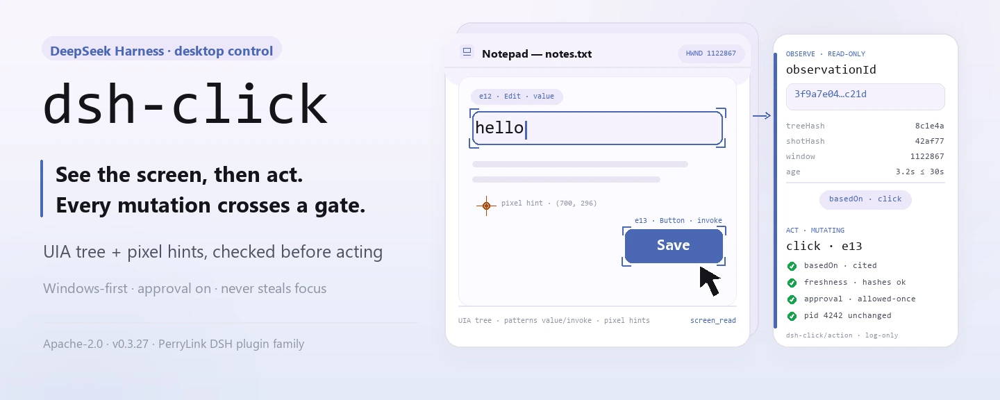
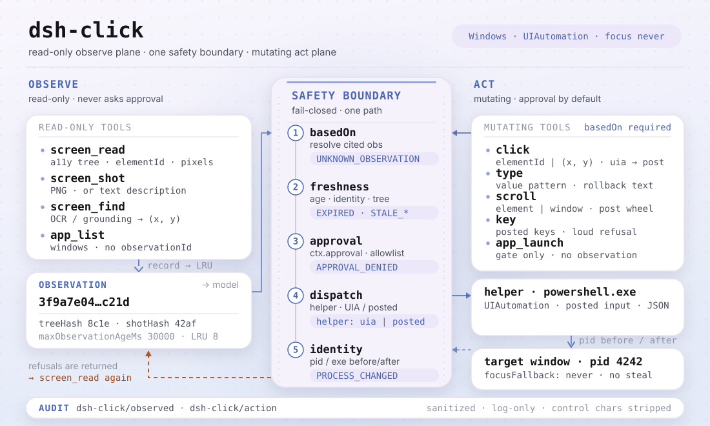

<div align="center">

<picture>
  <source media="(prefers-color-scheme: dark)" srcset="docs/assets/dsh-click-hero-en-dark.webp">
  
</picture>

# dsh-click

**स्क्रीन देखो, फिर काम करो — हर बदलाव वाला क्लिक मंज़ूरी से गुज़रता है, हर अवलोकन और कार्रवाई ऑडिट होती है।**

DeepSeek Harness के लिए नेटिव डेस्कटॉप नियंत्रण (Windows पहले): accessibility tree और pixel संकेत टेक्स्ट-मात्र मॉडल को «देखने» देते हैं, विंडो-स्कोप वाला क्लिक और इनपुट उसे «काम करने» देते हैं, और बीच में मंज़ूरी, ताज़गी तथा प्रक्रिया-पहचान की जाँचें रहती हैं।

[इंस्टॉल](#तीन-चरणों-में-शुरुआत) · [कॉन्फ़िगरेशन](#कॉन्फ़िगरेशन) · [FAQ](#faq) · [简体中文](README.md) · [English](README.en.md) · [Español](README.es.md) · [Português](README.pt.md) · [हिन्दी](README.hi.md)

[](LICENSE)
[](#संगतता)
[](https://www.npmjs.com/package/dsh-click)
[](https://github.com/PerryLink/dsh-click/actions/workflows/ci.yml)
[](#संगतता)

[](https://github.com/PerryLink/dsh-click/stargazers)
[](https://www.npmjs.com/package/dsh-click)
[](https://dshfind.com/plugins/PerryLink/dsh-click?ref=badge)
[](https://securityscorecards.dev/viewer/?uri=github.com/PerryLink/dsh-click)
[](https://dsh.market/)
[](https://gitee.com/perrylink/dsh-click)

```sh
dsh plugin --profile <name> add dsh-click
```

</div>

<sub>सामुदायिक प्लगइन, DeepSeek से असंबद्ध। कैनोनिकल रिपॉज़िटरी: <https://github.com/PerryLink/dsh-click> (Gitee एक मिरर है)।</sub>

## यह क्या है

`dsh-click` मॉडल को पूरा «देखो → करो» चक्र देता है: `screen_read` किसी विंडो का accessibility tree (तत्व id, प्रकार, नाम, आयत, समर्थित पैटर्न) और pixel स्थिति-संकेत पढ़ता है, या `screen_shot` तस्वीर लेता है; फिर `click` / `type` / `scroll` / `key` उसी विंडो पर तत्व id या निर्देशांक से काम करते हैं। हर बदलाव वाली कार्रवाई को ताज़ा अवलोकन (`basedOn`) उद्धृत करना ही होता है — स्क्रीन बदल गई या अवलोकन पुराना हुआ तो कार्रवाई मॉडल-पठनीय कारण के साथ अस्वीकार होती है; साथ ही डिफ़ॉल्ट रूप से `ctx.approval` से गुज़रती है और लक्ष्य प्रक्रिया की पहचान कार्रवाई से पहले व बाद में सत्यापित होती है। यह डिफ़ॉल्ट रूप से foreground फ़ोकस नहीं छीनता (`focusFallback: never`), और हर अवलोकन व कार्रवाई sanitized `dsh-click/observed` / `dsh-click/action` ऑडिट इवेंट बनती है।

<picture>
  <source media="(prefers-color-scheme: dark)" srcset="docs/assets/dsh-click-flow-v5-dark.svg">
  
</picture>

## तीन चरणों में शुरुआत

1. **इंस्टॉल करें** (एक चैनल चुनें):

   ```sh
   # git चैनल (नवीनतम main; git+https://github.com/PerryLink/dsh-click.git के बराबर)
   dsh plugin --profile web add github:PerryLink/dsh-click
   # npm चैनल (प्रकाशित रिलीज़)
   dsh plugin --profile web add dsh-click
   # tarball चैनल: इस रेपो में pnpm pack करके
   dsh plugin --profile web add ./dsh-click-<version>.tgz
   ```

   git चैनल का `prepare` स्क्रिप्ट केवल production निर्भरताओं से बनाता है।

2. **न्यूनतम कॉन्फ़िग** (डिफ़ॉल्ट से ही चलता है; केवल विशिष्ट विंडो छूट देने के लिए `autoApproveWindows` बदलें):

   ```yaml
   - insert:
       - id: dsh-click
         name: dsh-click
         config:
           requireApproval: true
           autoApproveWindows: ['^Notepad']
           focusFallback: never
   ```

3. **माउंट सत्यापित करें** (पुनः आरंभ के बाद):

   ```sh
   dsh --profile web --dump-config | grep -A3 'id: dsh-click'
   ```

   फिर agent से कहें कि विंडो देखकर काम करे — हर बदलाव वाली कार्रवाई पर मंज़ूरी का संकेत आता है:

   ```text
   > नोटपैड खोलो, "hello" टाइप करो, फिर स्क्रीन पर जो है उसे पढ़कर बताओ।
   ```

**अनइंस्टॉल**: `dsh plugin --profile web remove dsh-click` (या प्रोफ़ाइल पैच से वह पंक्ति हटाएँ)।

> अगर pnpm इस पैकेज के लिए `ERR_PNPM_IGNORED_BUILDS` दिखाए (esbuild की हानिरहित platform-binary जाँच), तो अपने `pnpm-workspace.yaml` में `allowBuilds: { esbuild: true }` जोड़ें — `dsh` CLI सटीक टुकड़ा छाप देता है।

<details>
<summary>DSH Desktop मार्केट से इंस्टॉल करें</summary>

सभी PerryLink प्लगइन DSH Desktop के अंतर्निहित मार्केट में ब्राउज़ किए जा सकते हैं: **Market → Sources → Add source → पेस्ट करें** `https://perrylink-dsh-catalog.perrylink.workers.dev/catalog-source.json` **→ चुनें**। इंस्टॉलेशन के लिए मार्केट की npm पहचान जाँच और आपकी पुष्टि आवश्यक रहती है।

</details>

## मुख्य क्षमताएँ

`dsh-click` नेटिव डेस्कटॉप को दो ऑडिट-योग्य पक्षों में बाँटता है — अवलोकन और कार्रवाई:

- **`screen_shot`** — विंडो (या मुख्य स्क्रीन) की तस्वीर लेकर `maxScreenshotSide` तक छोटा करता है। जो मॉडल तस्वीरें लेता है उसे परिणाम में चित्र मिलता है; केवल-टेक्स्ट मॉडल को टेक्स्ट विवरण मिलता है और वे भी चलते रहते हैं।
- **`screen_read`** — संरचित अवलोकन: accessibility tree (तत्व id, प्रकार, नाम, आयत, समर्थित पैटर्न) और रंगों सहित pixel स्थिति-संकेत — शुद्ध टेक्स्ट, कोई इमेज मॉडल ज़रूरी नहीं।
- **`screen_find`** — जिन ऐप्स में accessibility tree नहीं है, उनके लिए वैकल्पिक OCR (`ocr.*`, माउंट पर tesseract जाँचा जाता है) या visual grounding से क्लिक-योग्य टेक्स्ट/वर्णित लक्ष्य खोजता है और स्क्रीन निर्देशांक तथा `observationId` लौटाता है; यह केवल-पठन है और कभी मंज़ूरी नहीं माँगता।
- **`click` / `type` / `scroll` / `key`** — तत्व id या निर्देशांक से पता किए गए विंडो-स्कोप कार्रवाई। डिलीवरी UIA invoke पसंद करती है और posted विंडो संदेशों पर लौटती है, तथा डिफ़ॉल्ट रूप से foreground फ़ोकस कभी नहीं छीनती; `type` पहले UIA `ValuePattern` तेज़ रास्ता लेता है, फिर `SendInput` से असली कीस्ट्रोक डालता है (CJK-सुरक्षित); posted इनपुट अनदेखा करने वाले ऐप्स पर `key` ईमानदारी से विफलता बताता है।
- **`app_list` / `app_launch`** — चल रहे ऐप्स और उनकी दिखने वाली विंडो सूचीबद्ध करता है; नाम या executable पथ से ऐप लॉन्च करता है।

हर बदलाव वाली कार्रवाई एक ही सुरक्षा सीमा से गुज़रती है:

1. **ताज़गी** — कार्रवाई को `basedOn` अवलोकन उद्धृत करना होता है; करने से ठीक पहले विंडो फिर से कैप्चर होती है, और pixel hash (`staleCheckPixels`) या tree (`staleCheckTree`) बदला होने पर, या अवलोकन `maxObservationAgeMs` से पुराना होने पर कार्रवाई अस्वीकार होती है।
2. **मंज़ूरी** — डिफ़ॉल्ट रूप से हर कार्रवाई `ctx.approval` से गुज़रती है; `autoApproveWindows` के title/executable regex विशिष्ट विंडो छोड़ सकते हैं (वे भी ताज़गी, प्रक्रिया-पहचान और ऑडिट से गुज़रती हैं)।
3. **प्रक्रिया पहचान** — कार्रवाई से पहले **और** बाद में मालिक प्रक्रिया का pid व executable पथ सत्यापित होता है; बीच में बदलाव हो तो परिणाम ज़ोर से विफल होता है (`PROCESS_CHANGED`)।
4. **ऑडिट** — अवलोकन और कार्रवाई सत्र लॉग में `dsh-click/observed` / `dsh-click/action` इवेंट के रूप में दर्ज होते हैं (sanitized, केवल-लॉग)।

```text
मॉडल                          harness
  │ screen_read ──▶ observationId (+ तत्व, पिक्सेल)            ← संरचित टेक्स्ट
  │ click {basedOn, target} ──▶ ताज़गी जाँच ──▶ मंज़ूरी ──▶ helper (UIA)
  │                             pixel hash बदला? ── अस्वीकार + फिर देखो
  │                             कार्रवाई के बाद pid/exe बदला? ── PROCESS_CHANGED
  │ ◀── canonical JSON + ऑडिट इवेंट (dsh-click/action)
```

### टूल सतह

| टूल | केवल-पठन | मंज़ूरी चाहिए | नोट्स |
|---|---|---|---|
| `screen_shot` | ✅ | — | `observationId` लौटाता है जिसे बाद की कार्रवाइयाँ `basedOn` में उद्धृत करती हैं; मॉडल तस्वीरें ले तो चित्र संलग्न करता है |
| `screen_read` | ✅ | — | accessibility tree + pixel संकेत; तत्व id ही कार्रवाइयों का पता हैं |
| `screen_find` | ✅ | — | UIA tree न होने पर OCR/visual grounding; निर्देशांक लक्ष्य + `observationId` लौटाता है |
| `click` | | ✅ | `elementId` या `(x, y)` में से ठीक एक; पहले UIA invoke, फिर posted संदेश |
| `type` | | ✅ | केवल value पैटर्न वाले तत्व; विफलता पर नियंत्रण का टेक्स्ट बैकअप और बहाल करता है |
| `scroll` | | ✅ | तत्व (scroll पैटर्न) या विंडो (posted wheel) |
| `key` | | ✅ | posted कुंजी संयोजन (`"Ctrl+S"`); posted इनपुट अनदेखा करने वाले ऐप्स ज़ोर से अस्वीकार होते हैं |
| `app_list` | ✅ | — | चल रहे ऐप्स और उनकी दिखने वाली विंडो |
| `app_launch` | | ✅ | नाम या executable पथ से, वैकल्पिक आर्ग्युमेंट के साथ |

### उदाहरण

ये प्लगइन के वास्तविक प्रवेश बिंदु हैं; एक बार इंस्टॉल करके एक चलाएँ।

**विस्तृत उदाहरण** — कमांड `app_list`, इनपुट:

```json
{}
```

आउटपुट:

```text
1 running application(s) with windows:
- Demo (pid 4242, C:\Apps\demo.exe)
  - [windowId 1122867] "Demo App" at (10, 20) 800x600
```

*Observed from `plugins/dsh-click/tests/tools.spec.ts:159-185; renderer at src/tools.ts:933-942`*

**विफलता शाखा** — इनपुट:

```text
{}
```

आउटपुट:

```text
Error: dsh-click backend unavailable on linux: Linux backend is reserved but not implemented yet (Windows-first); only Windows can act today
```

*Observed from `plugins/dsh-click/src/platform/selection.ts:61-62,81; plugins/dsh-click/src/tools.ts:133-136; plugins/dsh-click/tests/tools.spec.ts:226-245`*

**संक्षिप्त उदाहरण**: `screen_read` · `app_list`

## कॉन्फ़िगरेशन

सभी विकल्प Schemastery `Config` फ़ील्ड हैं (cordis.yml से बदले जा सकते हैं)। id-लक्षित ओवरराइड पूरी पंक्ति बदल देता है — जो कुंजियाँ चाहिए वे सब दोबारा लिखें। `cordis.patch.yml` हर कुंजी का इनलाइन दस्तावेज़ देता है।

सबसे अधिक उपयोग होने वाली कुंजियाँ:

| कुंजी | डिफ़ॉल्ट | अर्थ |
|---|---|---|
| `requireApproval` | `true` | हर बदलाव वाली कार्रवाई मंज़ूरी से गुज़रती है; अवलोकन कभी नहीं पूछते |
| `autoApproveWindows` | `[]` | मंज़ूरी का सवाल छोड़ने वाले विंडो title/executable regex (ताज़गी, प्रक्रिया-पहचान और ऑडिट फिर भी लागू) |
| `focusFallback` | `never` | क्या कार्रवाई अंतिम उपाय के तौर पर लक्ष्य विंडो को foreground ला सकती है (`never` / `allow`) |
| `imageMode` | `auto` | `screen_shot` रेंडरिंग: `auto` (मॉडल तस्वीरें ले तो चित्र, वरना टेक्स्ट) या `text` |
| `staleCheckPixels` | `true` | हर कार्रवाई से पहले नया pixel hash तुलना करता है, बदलाव पर अस्वीकार |
| `staleCheckTree` | `target` | accessibility tree ताज़गी: `target` पता किए तत्व की जाँच (डिफ़ॉल्ट), `strict` किसी भी बदले नोड पर अस्वीकार, `off` पूरे tree hash को छोड़ता है (पहचान/आयु/pixel जाँचें लागू रहती हैं) |
| `maxObservationAgeMs` | `30000` | कार्रवाई कितने ms पुराना अवलोकन उद्धृत कर सकती है (1000..600000) |
| `auditSessionEvents` | `true` | `dsh-click/observed` / `dsh-click/action` ऑडिट इवेंट जोड़े जाएँ या नहीं; `false` ऑडिट appends पूरी तरह रोक देता है |

<details>
<summary>पूर्ण कॉन्फ़िगरेशन तालिका (17 पंक्तियाँ)</summary>

| कुंजी | डिफ़ॉल्ट | अर्थ |
|---|---|---|
| `requireApproval` | `true` | हर बदलाव वाली कार्रवाई मंज़ूरी से गुज़रती है; अवलोकन कभी नहीं पूछते |
| `autoApproveWindows` | `[]` | मंज़ूरी का सवाल छोड़ने वाले विंडो title/executable regex (ताज़गी, प्रक्रिया-पहचान और ऑडिट फिर भी लागू) |
| `auditSessionEvents` | `true` | `dsh-click/observed` / `dsh-click/action` सत्र ऑडिट इवेंट जोड़ता है। अनुकूली गेट बिना envelope वाले host पर append पहले ही छोड़ देता है (rc.6–rc.8, 0.1.1-rc.2, और 0.1.2-rc.1 जो पढ़ते समय अज्ञात प्रकार पर फेल-क्लोज़्ड है); `false` ऑडिट appends पूरी तरह रोक देता है। `0.1.2-rc.1` (2026-09-02 को अनुकूलित): सत्र envelope अपना ignorable फ़ील्ड केवल संग्रहीत-लॉग पठन संगतता के लिए रखता है — `Session.append` अभी भी इसे स्टैम्प नहीं कर सकता, इसलिए गेट व्यवहार अपरिवर्तित है |
| `focusFallback` | `never` | क्या कार्रवाई अंतिम उपाय के तौर पर लक्ष्य विंडो को foreground ला सकती है (`never` / `allow`) |
| `imageMode` | `auto` | `screen_shot` रेंडरिंग: `auto` (मॉडल तस्वीरें ले तो चित्र, वरना टेक्स्ट) या `text` |
| `helperTimeoutMs` | `30000` | प्रति helper कॉल टाइमआउट ms में (1..300000) |
| `maxHelperOutputBytes` | `25165824` | एक helper प्रतिक्रिया की बाइट सीमा (1024..67108864) |
| `maxScreenshotSide` | `2560` | स्क्रीनशॉट की सबसे लंबी भुजा पिक्सेल में (320..7680); बड़ी कैप्चर छोटी की जाती हैं |
| `staleCheckPixels` | `true` | हर कार्रवाई से पहले नया pixel hash तुलना करता है, बदलाव पर अस्वीकार |
| `staleCheckTree` | `target` | accessibility tree ताज़गी: `target` पता किए तत्व की जाँच (डिफ़ॉल्ट), `strict` किसी भी बदले नोड पर अस्वीकार, `off` घड़ी/कर्सर वाली विंडो के लिए पूरे tree hash को छोड़ता है (पहचान/आयु/pixel जाँचें लागू रहती हैं) |
| `maxObservationAgeMs` | `30000` | कार्रवाई कितने ms पुराना अवलोकन उद्धृत कर सकती है (1000..600000) |
| `maxCachedObservations` | `8` | कैश्ड अवलोकनों की LRU सीमा (1..64) |
| `maxElements` | `500` | प्रति `screen_read` accessibility तत्वों की सीमा (1..2000) |
| `maxTreeDepth` | `32` | accessibility tree traversal की अधिकतम गहराई (1..64) |
| `maxTextLength` | `200` | sanitized मॉडल-दृश्य स्ट्रिंग्स की truncation लंबाई (16..10000) |
| `rollbackEnabled` | `true` | `type` विफल होने पर नियंत्रण का टेक्स्ट बैकअप और बहाल करता है |
| `ocr.enabled` / `command` / `language` | `true` / `tesseract` / `eng` | `screen_find` पथ के लिए वैकल्पिक OCR (माउंट पर जाँचा जाता है; tesseract न हो तो अनुपलब्ध हो जाता है) |

</details>

आपके प्रोफ़ाइल पैच में ओवरराइड उदाहरण:

```yaml
- insert:
    - id: dsh-click
      name: dsh-click
      config:
        requireApproval: true
        autoApproveWindows: ['^Notepad']
        focusFallback: never
```

## FAQ

<details>
<summary>स्क्रीनशॉट और अवलोकन कहाँ रहते हैं? स्क्रीन सामग्री डिस्क पर जा सकती है?</summary>

`screen_shot` की तस्वीर harness के attachment store में जाती है (content-addressed, host की अपनी attachment नीति के अधीन) और मॉडल तक केवल उसी टूल परिणाम के ज़रिए पहुँचती है। अवलोकन स्वयं मेमोरी में रहते हैं (सीमित LRU, `maxCachedObservations`, रीस्टार्ट पर खो जाते हैं); इसके अलावा प्लगइन न डिस्क पर कुछ लिखता है, न नेटवर्क अनुरोध करता है, न क्रेडेंशियल रखता है। सत्र लॉग में केवल `dsh-click/*` ऑडिट इवेंट जाते हैं, और विंडो title, executable पथ तथा मुक्त टेक्स्ट लिखे या दिखाए जाने से पहले sanitized व लंबाई-सीमित होते हैं।

</details>

<details>
<summary>macOS / Linux पर क्या होता है? चुपचाप टूटता है?</summary>

कुछ भी मौन नहीं है। दोनों backend आरक्षित हैं पर लागू नहीं, इसलिए हर कॉल मॉडल-पठनीय कारण के साथ फेल-क्लोज़्ड होती है (`dsh-click backend unavailable on linux: ...`), और प्रोफ़ाइल हर जगह बूट होता रहता है। Windows पर `subprocess` सेवा न हो या helper उपलब्ध न हो तो कॉल ज़ोर से अस्वीकार होती है, सफलता का दिखावा नहीं।

</details>

<details>
<summary>क्या यह अन्य प्लगइनों से कमांड, सेवा या slot के लिए टकराता है?</summary>

यह कोई service key प्रदान नहीं करता और केवल दो वैकल्पिक seam उपभोग करता है (`dsh-click/backend`, `dsh-click/grounding`, परीक्षण/embedding के लिए); कोई क्लाइंट slot, कोई `webServer` रूट, कोई waterfall listener पंजीकृत नहीं करता; हर ऑडिट इवेंट `dsh-click/*` namespace में रहता है। हर टूल पंजीकरण `ctx.effect` में लिपटा है, इसलिए रोकने/हॉट-रिलोड पर केवल अपने पंजीकृत टूल हटते हैं।

</details>

<details>
<summary>प्रदर्शन लागत कितनी है? क्या हर कार्रवाई स्क्रीन फिर कैप्चर करती है?</summary>

अवलोकन माँग पर बनते हैं: `screen_read` केवल accessibility tree पढ़ता है (शुद्ध टेक्स्ट), जबकि `screen_shot` PNG एन्कोड करता है। हर बदलाव वाली कार्रवाई ताज़गी तुलना के लिए लक्ष्य विंडो एक बार फिर कैप्चर करती है (डिफ़ॉल्ट रूप से pixel hash और tree) — यह सुरक्षा सीमा का हिस्सा है। helper कॉल `helperTimeoutMs` / `maxHelperOutputBytes` से सीमित हैं, और अवलोकन कैश डिफ़ॉल्ट रूप से 8 प्रविष्टियाँ रखता है।

</details>

## सुरक्षा सीमाएँ

- **पहले देखो, फिर करो, हर बार।** कार्रवाइयों को ताज़ा अवलोकन उद्धृत करना होता है; बदली स्क्रीन (pixel hash) या पुराना अवलोकन मॉडल-पठनीय कारण के साथ अस्वीकार होता है और फिर देखने को कहता है।
- **मंज़ूरी डिफ़ॉल्ट है।** जब तक आप विशिष्ट विंडो छूट न दें, `requireApproval: true`; हर कार्रवाई — अनुमत या नहीं — ऑडिट होती है।
- **foreground फ़ोकस नहीं छीना जाता।** helper लक्ष्य विंडो को कभी foreground नहीं लाता (डिफ़ॉल्ट `focusFallback: 'never'`); इनपुट UIA या posted संदेशों से पहुँचता है ताकि पृष्ठभूमि विंडो पर असर न हो। `focusFallback: 'allow'` एकमात्र स्वीकृत अपवाद है।
- **प्रक्रिया पहचान फिर सत्यापित होती है** हर कार्रवाई से ठीक पहले और बाद में; बीच में प्रक्रिया बदलने पर परिणाम विफल होता है (`PROCESS_CHANGED`)।
- **sanitized आउटपुट।** नियंत्रण अक्षर हटाए जाते हैं, टैब संकुचित होते हैं, और क्रेडेंशियल-आकार के मान (कुंजियाँ, token, JWT, bearer हेडर) मॉडल या लॉग तक पहुँचने से पहले redact होते हैं।
- **फेल क्लोज़्ड।** असमर्थित प्लेटफ़ॉर्म, गायब subprocess सेवा या अनुपलब्ध helper हर कॉल को ज़ोर से अस्वीकार करते हैं — प्रोफ़ाइल हर जगह बूट होते रहते हैं।

## अनुमतियाँ और डेटा

- **अनुमतियाँ**: बदलाव वाली कार्रवाइयाँ आधिकारिक `ctx.approval` seam से गुज़रती हैं; प्लगइन उसे कभी दोबारा लागू या बायपास नहीं करता। `autoApproveWindows` केवल *विशिष्ट विंडो के लिए सवाल छोड़ता* है; वह ताज़गी या प्रक्रिया-पहचान जाँचें बंद नहीं कर सकता। `dshWorkshop` manifest `fs:read`, `subprocess:spawn`, `session:append`, `network:none`, `native-code:none` घोषित करता है।
- **डेटा**: attachment store में रखी तस्वीरों (content-addressed, harness की अपनी attachment नीति के अधीन) के अलावा प्लगइन डिस्क पर कुछ नहीं रखता। अवलोकन केवल मेमोरी में कैश होते हैं (सीमित LRU)। कोई नेटवर्क अनुरोध नहीं, कोई क्रेडेंशियल भंडारण नहीं।
- **सत्र लॉग**: `dsh-click/observed` और `dsh-click/action` केवल-लॉग ऑडिट इवेंट हैं जो sanitized विंडो/प्रक्रिया तथ्य ले जाते हैं; title, पथ और मुक्त टेक्स्ट लिखे या दिखाए जाने से पहले redact व लंबाई-सीमित होते हैं।

## ज्ञात सीमाएँ

- **Windows पहले।** macOS और Linux backend आरक्षित हैं; उन प्लेटफ़ॉर्म पर हर कॉल स्पष्ट कारण के साथ फेल-क्लोज़्ड होती है।
- **केवल-टेक्स्ट निष्ठा।** `screen_read` इस पर निर्भर है कि ऐप UIAutomation उजागर करे; accessibility tree न होने पर केवल pixel संकेत मिलते हैं, साथ में `screen_find` का OCR/grounding पथ। निर्देशांक से क्लिक उपलब्ध रहता है।
- **posted-इनपुट ऐप्स।** कुछ ऐप posted विंडो संदेश अनदेखा करते हैं (गेम, कुछ Electron सतहें); `key` सफलता का दिखावा नहीं करता, ईमानदारी से बताता है। 0.3.24 से `type` का `SendInput` fallback असली कीबोर्ड इनपुट और CJK टेक्स्ट संभालता है, पर लक्ष्य ऐप के अपने इनपुट मॉडल से सीमित रहता है।
- **बिना envelope वाले harness builds पर सत्र ऑडिट।** ऑडिट इवेंट अनुकूली गेट से गुज़रते हैं: जो host शब्दावली जानते हैं वे सीधे जोड़ते हैं, `ignorable` envelope वाले host मार्कर के साथ जोड़ते हैं, और बिना envelope वाले host — `0.1.0-rc.6`–`0.1.0-rc.8`, `0.1.1-rc.2`, और `0.1.2-rc.1` (जो ignorable मार्कर स्टैम्प नहीं कर सकता — envelope फ़ील्ड केवल संग्रहीत-लॉग पठन संगतता के लिए रखा गया है — और पढ़ते समय अज्ञात प्रकार पर फेल-क्लोज़्ड है) — को कोई ऑडिट append नहीं मिलता; टूल परिणाम ही पुनर्निर्माण योग्य ऑडिट ट्रेल रहते हैं। `auditSessionEvents: false` से ऑडिट appends पूरी तरह रोकें।

## अन्य DSH प्लगइनों के साथ इंटरऑपरेबिलिटी

`dsh-click` केवल टूल सतह उजागर करता है और अन्य प्लगइनों के seam में शामिल नहीं होता:

- **केवल दो हार्ड सेवाएँ।** `inject = ['tools', 'subprocess']`; कोई service key प्रदान नहीं करता, इसलिए सेवा-कुंजी टकराव असंभव।
- **कोई क्लाइंट या HTTP संसाधन नहीं।** कोई क्लाइंट slot, कोई `webServer` रूट, कोई `agent/pre-step` / `tools/post-execute` waterfall listener पंजीकृत नहीं करता, और globals नहीं बदलता।
- **namespaced ऑडिट।** केवल `dsh-click/observed` और `dsh-click/action` लिखता है; जब host शब्दावली नहीं जानता तो अनुकूली गेट उन्हें छोड़ देता है और टूल परिणाम ही पुनर्निर्माण योग्य ट्रेल रहते हैं।
- **वैकल्पिक seams degrade होते हैं।** `dsh-click/backend` और `dsh-click/grounding` केवल परीक्षण/embedding के लिए हैं; असली deployment प्लेटफ़ॉर्म चयन पर लौटता है और किसी अन्य प्लगइन की आवश्यकता नहीं रखता।
- **पंजीकरण प्रभाव हैं।** हर `ctx.tools.register` `ctx.effect` में लिपटा है, इसलिए रोकने/हॉट-रिलोड पर केवल अपने पंजीकृत टूल हटते हैं।

## संगतता

| सतह | स्थिति |
|---|---|
| Harness | DeepSeek Harness `dsh-v0.2.1-alpha.1` (GitHub tag, 2026-09-25 को सत्यापित)। 2026-09-11 को `dsh-v0.1.7-alpha.1` master checkout के विरुद्ध सत्यापित (पूर्ण गेट शृंखला + profile इंस्टॉल स्मोक)। `engines.dsh`: `>=0.2.1-0 <0.3.0 \|\| >=0.2.2-0 <0.3.0` |
| Node | `^22.19.0 \|\| >=24.9.0` |
| प्लेटफ़ॉर्म | **Windows पहले** (UIAutomation + Win32 इनपुट, साथ में PowerShell helper); macOS/Linux backend आरक्षित हैं और स्पष्ट कारण के साथ फेल-क्लोज़्ड होते हैं |
| मॉडल | केवल-टेक्स्ट मॉडल पूर्ण रूप से समर्थित (`screen_read` संरचित टेक्स्ट देता है); विज़न मॉडल को अतिरिक्त रूप से `screen_shot` चित्र मिलते हैं |

## इकोसिस्टम और गुणवत्ता

- [Gitee मिरर](https://gitee.com/perrylink/dsh-click) (सिंक मिरर; GitHub कैनोनिकल है)
- [dshfind प्लगइन पेज](https://dshfind.com/plugins/PerryLink/dsh-click) (इंस्टॉल और रैंकिंग)
- [OpenSSF Scorecard रिपोर्ट](https://securityscorecards.dev/viewer/?uri=github.com/PerryLink/dsh-click) ([.github/workflows/scorecard.yml](.github/workflows/scorecard.yml) द्वारा संचालित)
- [dsh-plugin-doctor सत्यापन रिपोर्ट](https://github.com/PerryLink/dsh-plugin-doctor#verified-徽章) (K10–K13 सभी `pass`)
- [DSH Market](https://dsh.market/) (सूचीबद्ध)
- **1024 स्टोर चैनल**: एक बार `npm i -g dsh1024`, फिर `dsh1024 plugin --profile web add dsh-click` ([deepseek1024.com](https://deepseek1024.com) इंस्टॉल रैंकिंग में गिना जाता है)
- [इकोसिस्टम नॉलेज बेस](https://perrylink.github.io/dsh-plugin-guide/) — मापे गए आँकड़े, मार्केटिंग नहीं: डेवलपमेंट गाइड · चयन डेटा · रखरखाव मानदंड

## डेवलपमेंट

```sh
pnpm install        # node ^22.19 || >=24
pnpm run typecheck  # tsc: src + tests, स्थानीय harness checkout के विरुद्ध
pnpm run typecheck:ci  # tsc: प्रकाशित host प्रकारों के विरुद्ध (paths बिना)
pnpm test           # vitest: 79 परीक्षण, 13 फ़ाइलें (helper smoke Windows पर चलता है)
pnpm run build      # tsdown bundle + tsc declarations (lib/)
pnpm run verify:self-contained  # निर्भरता स्पेक registry से हल होती हैं
pnpm run verify:artifacts       # बनी ESM सतह + native helper मौजूद
pnpm run check:readmes          # पाँच-भाषा README संगति
pnpm pack           # प्रकाशित tarball
```

README की छवियाँ [`scripts/gen-readme-assets.py`](scripts/gen-readme-assets.py) (Python + Pillow) से प्रोग्रामेटिक रूप में बनती हैं और सुरक्षित रूप से दोबारा चलाई जा सकती हैं: `python scripts/gen-readme-assets.py`।

Topics: `dsh`, `dsh-plugin`, `deepseek-harness`, `deepseek`, `cordis`, `computer-use`, `windows-automation`, `uiautomation`, `desktop-control`, `screen-reader`

## परिवार और आभार

यह प्रोजेक्ट [PerryLink](https://github.com/PerryLink) के DeepSeek Harness प्लगइन परिवार का हिस्सा है (सभी Apache-2.0)। अगर यह उपयोगी लगे, तो **एक स्टार अगले व्यक्ति को इसे खोजने में मदद करता है** — इसके पीछे कुछ भी लॉक नहीं है।

- [Windows helper स्मोक चेकलिस्ट](docs/windows-smoke.md) — 0.3.24+ के लिए असली इनपुट/फ़ोकस सत्यापन।
- [@LIU12312-Source](https://github.com/LIU12312-Source) — Windows helper के लिए असली `SendInput`/foreground-फ़ोकस fallback (PR #21)।
- [@Mchsd](https://github.com/Mchsd) — उन host के लिए `auditSessionEvents` opt-out जोड़ा जिनका सत्र रीडर `dsh-click` ऑडिट इवेंट अस्वीकार करता है (#2)।
- [@PerryLink](https://github.com/PerryLink) — निर्माता और रखरखावकर्ता: टूल सतह, कार्रवाई सुरक्षा सीमा, Windows native helper, sanitizers, और पाँच-भाषा दस्तावेज़।

<details>
<summary>सभी प्लगइन खोलें</summary>

| प्लगइन | स्थिति |
|---|---|
| **[dsh-aqua-input-check](https://github.com/PerryLink/dsh-aqua-input-check)** |  |
| **[dsh-archive-check](https://github.com/PerryLink/dsh-archive-check)** |  |
| **[dsh-auto-review](https://github.com/PerryLink/dsh-auto-review)** |  |
| **[dsh-autotier](https://github.com/PerryLink/dsh-autotier)** | 🧊 फ़्रोज़न — रेपो README देखें |
| **[dsh-bid-ca-precheck](https://github.com/PerryLink/dsh-bid-ca-precheck)** |  |
| **[dsh-bid-qual-check](https://github.com/PerryLink/dsh-bid-qual-check)** |  |
| **[dsh-cert-mcp](https://github.com/PerryLink/dsh-cert-mcp)** | 🧊 फ़्रोज़न — रेपो README देखें |
| **[dsh-checkpoint-rewind](https://github.com/PerryLink/dsh-checkpoint-rewind)** |  |
| **[dsh-click](https://github.com/PerryLink/dsh-click)** |  |
| **[dsh-composer-history](https://github.com/PerryLink/dsh-composer-history)** |  |
| **[dsh-contract-stance](https://github.com/PerryLink/dsh-contract-stance)** |  |
| **[dsh-customs-doc-check](https://github.com/PerryLink/dsh-customs-doc-check)** |  |
| **[dsh-data-quality](https://github.com/PerryLink/dsh-data-quality)** | 🧊 फ़्रोज़न — रेपो README देखें |
| **[dsh-demurrage-ledger](https://github.com/PerryLink/dsh-demurrage-ledger)** |  |
| **[dsh-doublecheck](https://github.com/PerryLink/dsh-doublecheck)** |  |
| **[dsh-drill-script-check](https://github.com/PerryLink/dsh-drill-script-check)** |  |
| **[dsh-eia-guide-check](https://github.com/PerryLink/dsh-eia-guide-check)** |  |
| **[dsh-emergency-plan](https://github.com/PerryLink/dsh-emergency-plan)** |  |
| **[dsh-essay-rubric-check](https://github.com/PerryLink/dsh-essay-rubric-check)** |  |
| **[dsh-evidence-check](https://github.com/PerryLink/dsh-evidence-check)** |  |
| **[dsh-export-ctl-check](https://github.com/PerryLink/dsh-export-ctl-check)** |  |
| **[dsh-fast](https://github.com/PerryLink/dsh-fast)** |  |
| **[dsh-fmea-table-check](https://github.com/PerryLink/dsh-fmea-table-check)** |  |
| **[dsh-forecast-penalty](https://github.com/PerryLink/dsh-forecast-penalty)** |  |
| **[dsh-fund-research](https://github.com/PerryLink/dsh-fund-research)** |  |
| **[dsh-github](https://github.com/PerryLink/dsh-github)** |  |
| **[dsh-gongwen-flow-check](https://github.com/PerryLink/dsh-gongwen-flow-check)** |  |
| **[dsh-gongwen-word-check](https://github.com/PerryLink/dsh-gongwen-word-check)** |  |
| **[dsh-guard-plan-qc](https://github.com/PerryLink/dsh-guard-plan-qc)** |  |
| **[dsh-hazchem-check](https://github.com/PerryLink/dsh-hazchem-check)** |  |
| **[dsh-hazplan-check](https://github.com/PerryLink/dsh-hazplan-check)** |  |
| **[dsh-hidden-risk-map](https://github.com/PerryLink/dsh-hidden-risk-map)** |  |
| **[dsh-hs-classify](https://github.com/PerryLink/dsh-hs-classify)** |  |
| **[dsh-icd-rule-check](https://github.com/PerryLink/dsh-icd-rule-check)** |  |
| **[dsh-industry-research](https://github.com/PerryLink/dsh-industry-research)** |  |
| **[dsh-lawcite-adapter](https://github.com/PerryLink/dsh-lawcite-adapter)** |  |
| **[dsh-laya](https://github.com/PerryLink/dsh-laya)** |  |
| **[dsh-lc-doc-check](https://github.com/PerryLink/dsh-lc-doc-check)** |  |
| **[dsh-learning-gap-check](https://github.com/PerryLink/dsh-learning-gap-check)** |  |
| **[dsh-library](https://github.com/PerryLink/dsh-library)** |  |
| **[dsh-local-ai](https://github.com/PerryLink/dsh-local-ai)** |  |
| **[dsh-lsp-actions](https://github.com/PerryLink/dsh-lsp-actions)** |  |
| **[dsh-mask](https://github.com/PerryLink/dsh-mask)** |  |
| **[dsh-mcp-panel](https://github.com/PerryLink/dsh-mcp-panel)** |  |
| **[dsh-medrec-qc](https://github.com/PerryLink/dsh-medrec-qc)** |  |
| **[dsh-memento](https://github.com/PerryLink/dsh-memento)** | 🧊 फ़्रोज़न — रेपो README देखें |
| **[dsh-nsfc-form-check](https://github.com/PerryLink/dsh-nsfc-form-check)** |  |
| **[dsh-nurse-record-check](https://github.com/PerryLink/dsh-nurse-record-check)** |  |
| **[dsh-observe](https://github.com/PerryLink/dsh-observe)** |  |
| **[dsh-origin-rvc-check](https://github.com/PerryLink/dsh-origin-rvc-check)** |  |
| **[dsh-ota-review-check](https://github.com/PerryLink/dsh-ota-review-check)** |  |
| **[dsh-output-styles](https://github.com/PerryLink/dsh-output-styles)** |  |
| **[dsh-paper-doc-adapter](https://github.com/PerryLink/dsh-paper-doc-adapter)** |  |
| **[dsh-permission-rules](https://github.com/PerryLink/dsh-permission-rules)** |  |
| **[dsh-permit-report-check](https://github.com/PerryLink/dsh-permit-report-check)** |  |
| **[dsh-pipeline-check](https://github.com/PerryLink/dsh-pipeline-check)** |  |
| **[dsh-pleading-draft](https://github.com/PerryLink/dsh-pleading-draft)** |  |
| **[dsh-plugin-doctor](https://github.com/PerryLink/dsh-plugin-doctor)** | 🚫 रिटायर्ड (रेपो संग्रहीत) |
| **[dsh-plugin-guide](https://github.com/PerryLink/dsh-plugin-guide)** |  |
| **[dsh-plugin-kit](https://github.com/PerryLink/dsh-plugin-kit)** | 🚫 रिटायर्ड (रेपो संग्रहीत) |
| **[dsh-plugin-upgrade](https://github.com/PerryLink/dsh-plugin-upgrade)** | 🚫 रिटायर्ड (रेपो संग्रहीत) |
| **[dsh-policy-brief-draft](https://github.com/PerryLink/dsh-policy-brief-draft)** |  |
| **[dsh-power-loss-split](https://github.com/PerryLink/dsh-power-loss-split)** |  |
| **[dsh-power-ticket-check](https://github.com/PerryLink/dsh-power-ticket-check)** |  |
| **[dsh-ppap-check](https://github.com/PerryLink/dsh-ppap-check)** |  |
| **[dsh-protest-deadline](https://github.com/PerryLink/dsh-protest-deadline)** |  |
| **[dsh-railway-window](https://github.com/PerryLink/dsh-railway-window)** |  |
| **[dsh-repair-order-qc](https://github.com/PerryLink/dsh-repair-order-qc)** |  |
| **[dsh-research-report](https://github.com/PerryLink/dsh-research-report)** |  |
| **[dsh-review-reply-check](https://github.com/PerryLink/dsh-review-reply-check)** |  |
| **[dsh-rulefile-check](https://github.com/PerryLink/dsh-rulefile-check)** |  |
| **[dsh-safety-brief-check](https://github.com/PerryLink/dsh-safety-brief-check)** |  |
| **[dsh-score](https://github.com/PerryLink/dsh-score)** | 🧊 फ़्रोज़न — रेपो README देखें |
| **[dsh-session-sync](https://github.com/PerryLink/dsh-session-sync)** |  |
| **[dsh-site-log-check](https://github.com/PerryLink/dsh-site-log-check)** |  |
| **[dsh-skill-pack-security](https://github.com/PerryLink/dsh-skill-pack-security)** |  |
| **[dsh-soe-decision-check](https://github.com/PerryLink/dsh-soe-decision-check)** |  |
| **[dsh-soilwater-check](https://github.com/PerryLink/dsh-soilwater-check)** |  |
| **[dsh-sop-sync-check](https://github.com/PerryLink/dsh-sop-sync-check)** |  |
| **[dsh-spc-gbt-adapter](https://github.com/PerryLink/dsh-spc-gbt-adapter)** |  |
| **[dsh-talk](https://github.com/PerryLink/dsh-talk)** |  |
| **[dsh-tender-extract](https://github.com/PerryLink/dsh-tender-extract)** |  |
| **[dsh-tender-matrix](https://github.com/PerryLink/dsh-tender-matrix)** |  |
| **[dsh-test-drive](https://github.com/PerryLink/dsh-test-drive)** |  |
| **[dsh-ticktick](https://github.com/PerryLink/dsh-ticktick)** | 🚫 रिटायर्ड (रेपो संग्रहीत) |
| **[dsh-translate](https://github.com/PerryLink/dsh-translate)** |  |
| **[dsh-warranty-calc](https://github.com/PerryLink/dsh-warranty-calc)** |  |
| **[dsh-budget](https://github.com/PerryLink/dsh-budget)** | 🧊 फ़्रोज़न — रेपो README देखें |
| **[dsh-claude-move](https://github.com/PerryLink/dsh-claude-move)** | 🧊 फ़्रोज़न — रेपो README देखें |
| **[dsh-defend](https://github.com/PerryLink/dsh-defend)** | 🧊 फ़्रोज़न — रेपो README देखें |
| **[dsh-draw](https://github.com/PerryLink/dsh-draw)** | 🧊 फ़्रोज़न — रेपो README देखें |
| **[dsh-reach](https://github.com/PerryLink/dsh-reach)** | 🧊 फ़्रोज़न — रेपो README देखें |
| **[dsh-background-agents](https://github.com/PerryLink/dsh-background-agents)** | 🚫 रिटायर्ड (रेपो संग्रहीत) |
| **[dsh-session-pin](https://github.com/PerryLink/dsh-session-pin)** | 🚫 रिटायर्ड (रेपो संग्रहीत) |
| **[dsh-team-rooms](https://github.com/PerryLink/dsh-team-rooms)** | 🚫 रिटायर्ड (रेपो संग्रहीत) |

</details>

## लाइसेंस

[LICENSE](LICENSE) (Apache License 2.0) © 2026 dsh-click contributors

<p align="center"><sub>Apache-2.0 · सामुदायिक प्लगइन, DeepSeek से असंबद्ध।</sub></p>
