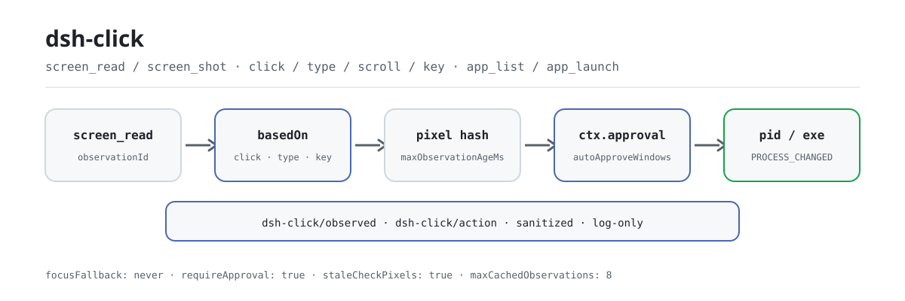

<div align="center">

<picture>
  <source media="(prefers-color-scheme: dark)" srcset="docs/assets/dsh-click-flow-dark.svg">
  
</picture>

# dsh-click

**Ver a tela e depois agir: cada clique é autorizado e cada observação e ação fica auditada.**

Controle nativo do desktop para o DeepSeek Harness (Windows primeiro): a árvore de acessibilidade e as dicas de píxeis deixam um modelo só de texto «ver», o clique e a entrada com escopo de janela deixam-no «agir», e a aprovação, a frescura e a identidade do processo ficam pelo meio.

[Instalar](#instalação-em-três-passos) · [Configuração](#configuração) · [FAQ](#faq) · [简体中文](README.md) · [English](README.en.md) · [Español](README.es.md) · [Português](README.pt.md) · [हिन्दी](README.hi.md)

[](LICENSE)
[](#compatibilidade)
[](https://www.npmjs.com/package/dsh-click)
[](https://github.com/PerryLink/dsh-click/actions/workflows/ci.yml)
[](#compatibilidade)

[](https://github.com/PerryLink/dsh-click/stargazers)
[](https://www.npmjs.com/package/dsh-click)
[](https://dshfind.com/plugins/PerryLink/dsh-click?ref=badge)
[](https://securityscorecards.dev/viewer/?uri=github.com/PerryLink/dsh-click)
[](https://dsh.market/)
[](https://gitee.com/perrylink/dsh-click)

```sh
dsh plugin --profile <name> add dsh-click
```

</div>

<sub>Plugin da comunidade, sem afiliação com a DeepSeek. Repositório canônico: <https://github.com/PerryLink/dsh-click> (o Gitee é um espelho).</sub>

## O que é

O `dsh-click` dá ao modelo um ciclo completo de observar → agir: `screen_read` lê a árvore de acessibilidade de uma janela (ids de elemento, tipos, nomes, retângulos, padrões suportados) mais dicas de posição e cor, ou `screen_shot` captura uma imagem; depois `click` / `type` / `scroll` / `key` agem nessa mesma janela por id de elemento ou coordenadas. Toda ação mutante precisa citar uma observação fresca (`basedOn`); se a tela mudou ou a observação expirou, a ação é recusada com um motivo legível para o modelo; além disso passa por `ctx.approval` por padrão, e a identidade do processo alvo é verificada antes e depois. Não rouba o foco de primeiro plano por padrão (`focusFallback: never`), e cada observação e ação vira um evento de auditoria `dsh-click/observed` / `dsh-click/action` já sanitizado.

## Instalação em três passos

1. **Instale** (escolha um canal):

   ```sh
   # canal git (último main; equivalente a git+https://github.com/PerryLink/dsh-click.git)
   dsh plugin --profile web add github:PerryLink/dsh-click
   # canal npm (versões publicadas)
   dsh plugin --profile web add dsh-click
   # canal tarball: pnpm pack neste repo e depois
   dsh plugin --profile web add ./dsh-click-<version>.tgz
   ```

   O script `prepare` do canal git compila apenas com dependências de produção.

2. **Configuração mínima** (os padrões já funcionam; mexa em `autoApproveWindows` só para isentar janelas específicas):

   ```yaml
   - insert:
       - id: dsh-click
         name: dsh-click
         config:
           requireApproval: true
           autoApproveWindows: ['^Notepad']
           focusFallback: never
   ```

3. **Verifique que montou** (após reiniciar):

   ```sh
   dsh --profile web --dump-config | grep -A3 'id: dsh-click'
   ```

   Depois peça ao agente para olhar uma janela e agir: o pedido de aprovação aparece para cada ação mutante:

   ```text
   > Abra o Bloco de Notas, digite "hello" e leia de volta o que está na tela.
   ```

**Desinstalar**: `dsh plugin --profile web remove dsh-click` (ou remova a linha do patch de perfil).

> Se o pnpm reportar `ERR_PNPM_IGNORED_BUILDS` para este pacote (a validação inofensiva do binário de plataforma do esbuild), adicione `allowBuilds: { esbuild: true }` ao seu `pnpm-workspace.yaml`; a CLI do `dsh` imprime o trecho exato.

<details>
<summary>Instalar a partir do mercado do DSH Desktop</summary>

Todo plugin PerryLink está listado no mercado integrado do DSH Desktop: **Market → Sources → Add source → colar** `https://perrylink-dsh-catalog.perrylink.workers.dev/catalog-source.json` **→ selecionar**. A instalação ainda exige a verificação de identidade npm do mercado e a sua confirmação.

</details>

## Capacidades principais

O `dsh-click` separa o desktop nativo numa face de observação e noutra de ação, ambas auditáveis:

- **`screen_shot`** — captura uma janela (ou a tela principal) e a reduz para `maxScreenshotSide`. Com um modelo que aceita imagens o resultado leva a imagem; modelos só de texto recebem uma descrição textual e continuam funcionando.
- **`screen_read`** — a observação estruturada: a árvore de acessibilidade (ids de elemento, tipos, nomes, retângulos, padrões suportados) mais dicas de posição de píxeis com cores; texto puro, sem precisar de modelo de imagem.
- **`screen_find`** — para aplicações sem árvore de acessibilidade, encontra texto clicável ou um alvo visual descrito via OCR opcional (`ocr.*`, tesseract sondado ao montar) ou grounding visual, devolvendo coordenadas de tela mais um `observationId`; é só leitura e nunca pede aprovação.
- **`click` / `type` / `scroll` / `key`** — ações com escopo de janela endereçadas por id de elemento ou coordenadas. A entrega prefere invocação UIA e recorre a mensagens de janela postadas, e por padrão nunca rouba o foco de primeiro plano; `type` usa o caminho rápido `ValuePattern` do UIA e, se falhar, injeta teclas reais via `SendInput` (seguro para CJK); `key` reporta com honestidade quando uma app ignora a entrada postada.
- **`app_list` / `app_launch`** — enumera aplicações em execução e as suas janelas visíveis; lança uma por nome ou caminho do executável.

Toda ação mutante cruza a mesma fronteira de segurança:

1. **Frescura** — a ação precisa citar uma observação `basedOn`; a janela é recapturada imediatamente antes de agir e a ação é recusada se o hash de píxeis (`staleCheckPixels`) ou a árvore (`staleCheckTree`) mudou, ou se a observação passou de `maxObservationAgeMs`.
2. **Aprovação** — `ctx.approval` controla cada ação por padrão; os regex de título/executável de `autoApproveWindows` podem isentar janelas específicas (continuam a passar por frescura, identidade de processo e auditoria).
3. **Identidade do processo** — o pid e o caminho do executável proprietário são verificados antes **e** depois de agir; uma troca a meio da ação falha em voz alta (`PROCESS_CHANGED`).
4. **Auditoria** — observações e ações ficam no registro de sessão como eventos `dsh-click/observed` / `dsh-click/action` (sanitizados, só registro).

```text
modelo                          harness
  │ screen_read ──▶ observationId (+ elementos, píxeis)       ← texto estruturado
  │ click {basedOn, target} ──▶ checagem de frescura ──▶ aprovação ──▶ helper (UIA)
  │                             hash de píxeis mudou? ── recusa + re-observa
  │                             pid/exe mudou após agir? ── PROCESS_CHANGED
  │ ◀── JSON canônico + eventos de auditoria (dsh-click/action)
```

### Superfície de ferramentas

| Ferramenta | Só leitura | Precisa de aprovação | Notas |
|---|---|---|---|
| `screen_shot` | ✅ | — | Devolve um `observationId` que ações posteriores citam em `basedOn`; anexa imagem quando o modelo aceita imagens |
| `screen_read` | ✅ | — | Árvore de acessibilidade + dicas de píxeis; os ids de elemento são o endereço das ações |
| `screen_find` | ✅ | — | OCR/grounding visual quando não há árvore UIA; devolve alvos por coordenadas + um `observationId` |
| `click` | | ✅ | Exatamente um de `elementId` ou `(x, y)`; prefere UIA invoke, com mensagens postadas como fallback |
| `type` | | ✅ | Só elementos com padrão de valor; faz backup e restaura o texto do controle se falhar |
| `scroll` | | ✅ | Elemento (padrão scroll) ou janela (roda postada) |
| `key` | | ✅ | Combinações de teclas postadas (`"Ctrl+S"`); apps que ignoram a entrada postada são recusadas em voz alta |
| `app_list` | ✅ | — | Aplicações em execução e as suas janelas visíveis |
| `app_launch` | | ✅ | Por nome ou caminho do executável, com argumentos opcionais |

### Exemplos

Estes são os pontos de entrada reais do plugin; instale uma vez e chame um.

**Exemplo detalhado** — comando `app_list`, entrada:

```json
{}
```

Saída:

```text
1 running application(s) with windows:
- Demo (pid 4242, C:\Apps\demo.exe)
  - [windowId 1122867] "Demo App" at (10, 20) 800x600
```

*Observed from `plugins/dsh-click/tests/tools.spec.ts:159-185; renderer at src/tools.ts:933-942`*

**Ramo de falha** — entrada:

```text
{}
```

Saída:

```text
Error: dsh-click backend unavailable on linux: Linux backend is reserved but not implemented yet (Windows-first); only Windows can act today
```

*Observed from `plugins/dsh-click/src/platform/selection.ts:61-62,81; plugins/dsh-click/src/tools.ts:133-136; plugins/dsh-click/tests/tools.spec.ts:226-245`*

**Exemplos breves**: `screen_read` · `app_list`

## Configuração

Todas as opções são campos Schemastery `Config` (alteráveis via cordis.yml). Uma sobrescrita direcionada por id substitui a linha inteira: repita todas as chaves de que precisar. O `cordis.patch.yml` documenta cada chave inline.

Chaves mais usadas:

| Chave | Padrão | Significado |
|---|---|---|
| `requireApproval` | `true` | Toda ação mutante passa por aprovação; observadores nunca perguntam |
| `autoApproveWindows` | `[]` | Regex de título/executável que dispensam a pergunta de aprovação (continuam com frescura, identidade de processo e auditoria) |
| `focusFallback` | `never` | Se uma ação pode trazer a janela alvo para o primeiro plano como último recurso (`never` / `allow`) |
| `imageMode` | `auto` | Renderização de `screen_shot`: `auto` (imagem quando o modelo aceita imagens, texto caso contrário) ou `text` |
| `staleCheckPixels` | `true` | Compara um hash de píxeis fresco antes de cada ação e recusa se mudou |
| `staleCheckTree` | `target` | Frescura da árvore de acessibilidade: `target` verifica o elemento endereçado (padrão), `strict` recusa qualquer nó alterado, `off` ignora o hash da árvore (identidade/idade/píxeis continuam valendo) |
| `maxObservationAgeMs` | `30000` | Idade máxima em ms de uma observação que uma ação pode citar (1000..600000) |
| `auditSessionEvents` | `true` | Se anexa os eventos de auditoria `dsh-click/observed` / `dsh-click/action`; `false` interrompe por completo os appends de auditoria |

<details>
<summary>Tabela completa de configuração (17 linhas)</summary>

| Chave | Padrão | Significado |
|---|---|---|
| `requireApproval` | `true` | Toda ação mutante passa por aprovação; observadores nunca perguntam |
| `autoApproveWindows` | `[]` | Regex de título/executável que dispensam a pergunta de aprovação (continuam com frescura, identidade de processo e auditoria) |
| `auditSessionEvents` | `true` | Anexa os eventos de sessão `dsh-click/observed` / `dsh-click/action`. O portão adaptativo já dispensa o append em hosts sem envelope (rc.6–rc.8, 0.1.1-rc.2 e 0.1.2-rc.1, que falha fechado para tipos desconhecidos na leitura); `false` interrompe por completo os appends de auditoria. `0.1.2-rc.1` (adaptado em 2026-09-02): o envelope de sessão mantém o campo ignorable apenas para compatibilidade de leitura de logs armazenados — o `Session.append` ainda não consegue estampá-lo, então o comportamento do portão não muda |
| `focusFallback` | `never` | Se uma ação pode trazer a janela alvo para o primeiro plano como último recurso (`never` / `allow`) |
| `imageMode` | `auto` | Renderização de `screen_shot`: `auto` (imagem quando o modelo aceita imagens, texto caso contrário) ou `text` |
| `helperTimeoutMs` | `30000` | Timeout por chamada ao helper em ms (1..300000) |
| `maxHelperOutputBytes` | `25165824` | Limite de uma resposta do helper em bytes (1024..67108864) |
| `maxScreenshotSide` | `2560` | Lado mais longo de uma captura em píxeis (320..7680); capturas maiores são reduzidas |
| `staleCheckPixels` | `true` | Compara um hash de píxeis fresco antes de cada ação e recusa se mudou |
| `staleCheckTree` | `target` | Frescura da árvore de acessibilidade: `target` verifica o elemento endereçado (padrão), `strict` recusa qualquer nó alterado, `off` ignora o hash da árvore inteira em janelas com relógio/cursor em movimento (identidade/idade/píxeis continuam valendo) |
| `maxObservationAgeMs` | `30000` | Idade máxima em ms de uma observação que uma ação pode citar (1000..600000) |
| `maxCachedObservations` | `8` | Limite LRU de observações em cache (1..64) |
| `maxElements` | `500` | Limite de elementos de acessibilidade por `screen_read` (1..2000) |
| `maxTreeDepth` | `32` | Profundidade máxima da travessia da árvore de acessibilidade (1..64) |
| `maxTextLength` | `200` | Comprimento de truncamento das strings visíveis ao modelo já sanitizadas (16..10000) |
| `rollbackEnabled` | `true` | Faz backup e restaura o texto do controle quando `type` falha |
| `ocr.enabled` / `command` / `language` | `true` / `tesseract` / `eng` | OCR opcional para o caminho `screen_find` (sondado ao montar; degrada para indisponível sem tesseract) |

</details>

Exemplo de sobrescrita no seu patch de perfil:

```yaml
- insert:
    - id: dsh-click
      name: dsh-click
      config:
        requireApproval: true
        autoApproveWindows: ['^Notepad']
        focusFallback: never
```

## FAQ

<details>
<summary>Onde ficam as capturas e as observações? O conteúdo da tela pode parar no disco?</summary>

A imagem de `screen_shot` vai para o attachment store do harness (endereçada por conteúdo, sob a política de anexos do host) e é entregue ao modelo apenas por esse resultado de ferramenta. As observações ficam em memória (LRU limitada, `maxCachedObservations`, perdidas ao reiniciar); fora disso o plugin não escreve nada no disco, não faz requisições de rede e não guarda credenciais. O único conteúdo que chega ao registro de sessão são os eventos de auditoria `dsh-click/*`, e títulos de janela, caminhos e texto livre são sanitizados e truncados antes de serem escritos ou exibidos.

</details>

<details>
<summary>O que acontece no macOS / Linux? Quebra silenciosa?</summary>

Nada é silencioso. Ambos os backends estão reservados mas não implementados, então cada chamada falha fechada com um motivo legível para o modelo (`dsh-click backend unavailable on linux: ...`), e o perfil continua iniciando em qualquer plataforma. No Windows, um serviço `subprocess` ausente ou um helper indisponível recusam a chamada em voz alta em vez de fingir sucesso.

</details>

<details>
<summary>Ele briga com outros plugins por comandos, serviços ou slots?</summary>

Não fornece nenhuma chave de serviço e consome apenas dois seams opcionais (`dsh-click/backend`, `dsh-click/grounding`, para testes/embeddings); não registra slots de cliente, nem rotas `webServer`, nem listeners waterfall; cada evento de auditoria vive no namespace `dsh-click/*`. Cada registro de ferramenta fica dentro de `ctx.effect`, então parar ou recarregar a quente remove exatamente as ferramentas que ele registrou.

</details>

<details>
<summary>Qual é o custo de desempenho? Cada ação recaptura a tela?</summary>

As observações são produzidas sob demanda: `screen_read` só percorre a árvore de acessibilidade (texto puro), enquanto `screen_shot` codifica um PNG. Cada ação mutante recaptura uma vez a janela alvo para a comparação de frescura (hash de píxeis mais árvore por padrão), e isso faz parte da fronteira de segurança. As chamadas ao helper são limitadas por `helperTimeoutMs` / `maxHelperOutputBytes`, e o cache de observações guarda 8 entradas por padrão.

</details>

## Limites de segurança

- **Observar antes de agir, sempre.** As ações precisam citar uma observação fresca; uma tela alterada (hash de píxeis) ou uma observação expirada são recusadas com um motivo legível para o modelo que exige re-observar.
- **Aprovação é o padrão.** `requireApproval: true` a menos que isente janelas específicas; cada ação — permitida ou não — fica auditada.
- **Sem roubo de primeiro plano.** O helper nunca traz uma janela alvo para o primeiro plano (`focusFallback: 'never'` por padrão); a entrada é entregue por UIA ou mensagens postadas para não perturbar janelas em segundo plano. `focusFallback: 'allow'` é a única exceção sancionada.
- **A identidade do processo é re-verificada** imediatamente antes e depois de cada ação; uma troca de processo a meio da ação falha o resultado (`PROCESS_CHANGED`).
- **Saída sanitizada.** Caracteres de controle são removidos, tabulações são colapsadas e valores com forma de credencial (chaves, tokens, JWTs, cabeçalhos bearer) são redigidos antes de chegarem ao modelo ou ao log.
- **Falha fechada.** Plataformas não suportadas, um serviço de subprocesso ausente ou um helper indisponível recusam cada chamada em voz alta; os perfis continuam iniciando em qualquer lugar.

## Permissões e dados

- **Permissões**: as ações mutantes cruzam o seam oficial `ctx.approval`; o plugin nunca o reimplementa nem o contorna. `autoApproveWindows` apenas *dispensa a pergunta para janelas específicas*; não consegue desativar as checagens de frescura nem de identidade de processo. O manifest `dshWorkshop` declara `fs:read`, `subprocess:spawn`, `session:append`, `network:none`, `native-code:none`.
- **Dados**: o plugin não grava nada no disco além das capturas que o attachment store mantém (endereçadas por conteúdo, sob a política de anexos do harness). As observações ficam em cache na memória (LRU limitada). Sem requisições de rede nem armazenamento de credenciais.
- **Registro de sessão**: `dsh-click/observed` e `dsh-click/action` são eventos de auditoria só-registro que carregam fatos sanitizados de janela/processo; títulos, caminhos e texto livre são redigidos e truncados antes de serem escritos ou exibidos.

## Limitações conhecidas

- **Windows primeiro.** Os backends de macOS e Linux estão reservados; nessas plataformas cada chamada falha fechada com um motivo claro.
- **Fidelidade de só texto.** `screen_read` depende de a aplicação expor UIAutomation; apps sem árvore acessível dão apenas dicas de píxeis, mais o caminho OCR/grounding do `screen_find`. Os cliques por coordenadas continuam disponíveis.
- **Apps de entrada postada.** Algumas aplicações ignoram mensagens de janela postadas (jogos, algumas superfícies Electron); `key` reporta isso com honestidade em vez de fingir sucesso. Desde 0.3.24 o fallback `SendInput` do `type` cobre entrada de teclado real e texto CJK, mas continua limitado pelo modelo de entrada da app alvo.
- **Auditoria de sessão em builds sem envelope.** Os eventos de auditoria passam por um portão adaptativo: hosts que conhecem o vocabulário anexam diretamente, hosts com envelope `ignorable` anexam com o marcador, e hosts sem envelope — `0.1.0-rc.6`–`0.1.0-rc.8`, `0.1.1-rc.2` e `0.1.2-rc.1` (que não consegue estampar o marcador ignorable — o campo do envelope é mantido apenas para compatibilidade de leitura de logs armazenados — e falha fechado para tipos desconhecidos na leitura) — não recebem append de auditoria; os resultados das ferramentas continuam sendo o rastro de auditoria reconstruível. Defina `auditSessionEvents: false` para interromper por completo os appends de auditoria.

## Interoperabilidade com outros plugins DSH

O `dsh-click` expõe apenas uma superfície de ferramentas e não entra nos seams de outros plugins:

- **Apenas dois serviços duros.** `inject = ['tools', 'subprocess']`; não fornece nenhuma chave de serviço, então não pode colidir numa.
- **Sem recursos de cliente nem HTTP.** Não registra slots de cliente, nem rotas `webServer`, nem listeners waterfall `agent/pre-step` / `tools/post-execute`, e não muta globais.
- **Auditoria com namespace.** Escreve apenas `dsh-click/observed` e `dsh-click/action`; quando um host não conhece o vocabulário, o portão adaptativo os dispensa e os resultados das ferramentas continuam sendo o rastro reconstruível.
- **Seams opcionais que degradam.** `dsh-click/backend` e `dsh-click/grounding` existem só para testes/embeddings; implantações reais caem na seleção de plataforma e não exigem nenhum outro plugin.
- **Registros são efeitos.** Cada `ctx.tools.register` fica envolvido em `ctx.effect`, então parar ou recarregar a quente remove exatamente as ferramentas que ele registrou.

## Compatibilidade

| Superfície | Status |
|---|---|
| Harness | DeepSeek Harness `dsh-v0.2.1-alpha.1` (tag do GitHub, verificado em 2026-09-25). Verificado em 2026-09-11 contra o checkout master `dsh-v0.1.7-alpha.1` (cadeia completa de portões + smoke de instalação de perfil). `engines.dsh`: `>=0.2.1-0 <0.3.0 \|\| >=0.2.2-0 <0.3.0` |
| Node | `^22.19.0 \|\| >=24.9.0` |
| Plataformas | **Windows primeiro** (UIAutomation + entrada Win32, via um helper PowerShell incluído); os backends de macOS/Linux estão reservados e falham fechados com um motivo claro |
| Modelo | Modelos só de texto totalmente suportados (`screen_read` devolve texto estruturado); modelos de visão recebem além disso imagens do `screen_shot` |

## Ecossistema e qualidade

- [Espelho Gitee](https://gitee.com/perrylink/dsh-click) (espelho de sincronização; o GitHub é o canônico)
- [Página do plugin no dshfind](https://dshfind.com/plugins/PerryLink/dsh-click) (instalações e ranking)
- [Relatório OpenSSF Scorecard](https://securityscorecards.dev/viewer/?uri=github.com/PerryLink/dsh-click) (alimentado por [.github/workflows/scorecard.yml](.github/workflows/scorecard.yml))
- [Relatório de verificação dsh-plugin-doctor](https://github.com/PerryLink/dsh-plugin-doctor#verified-徽章) (K10–K13 todos `pass`)
- [DSH Market](https://dsh.market/) (listado)
- **Canal 1024 store**: `npm i -g dsh1024` uma vez, depois `dsh1024 plugin --profile web add dsh-click` (conta para o ranking de instalações do [deepseek1024.com](https://deepseek1024.com))
- [Base de conhecimento do ecossistema](https://perrylink.github.io/dsh-plugin-guide/) — dados medidos, não marketing: guia de desenvolvimento de plugins · dados de seleção · critérios de manutenção

## Desenvolvimento

```sh
pnpm install        # node ^22.19 || >=24
pnpm run typecheck  # tsc: src + tests contra o checkout local do harness
pnpm run typecheck:ci  # tsc contra os tipos publicados do host (sem paths)
pnpm test           # vitest: 79 testes, 13 arquivos (o smoke do helper roda no Windows)
pnpm run build      # bundle tsdown + declarações tsc (lib/)
pnpm run verify:self-contained  # as specs de dependências resolvem pelo registry
pnpm run verify:artifacts       # face ESM construída + helper nativo presente
pnpm run check:readmes          # consistência dos README em cinco idiomas
pnpm pack           # o tarball publicado
```

As imagens do README são geradas programaticamente por [`scripts/gen-readme-assets.py`](scripts/gen-readme-assets.py) (Python + Pillow) e podem ser reexecutadas com segurança: `python scripts/gen-readme-assets.py`.

Topics: `dsh`, `dsh-plugin`, `deepseek-harness`, `deepseek`, `cordis`, `computer-use`, `windows-automation`, `uiautomation`, `desktop-control`, `screen-reader`

## Família e agradecimentos

Este projeto faz parte da família de plugins do DeepSeek Harness da [PerryLink](https://github.com/PerryLink) (todos Apache-2.0). Se for útil, **uma estrela ajuda a próxima pessoa a encontrá-lo** — nada fica bloqueado atrás dela.

- [Checklist de smoke do helper do Windows](docs/windows-smoke.md) — verificação real de entrada/foco para 0.3.24+.
- [@LIU12312-Source](https://github.com/LIU12312-Source) — fallback real de `SendInput`/foco em primeiro plano para o helper do Windows (PR #21).
- [@Mchsd](https://github.com/Mchsd) — adicionou a opção `auditSessionEvents` para hosts cujo leitor de sessão recusa os eventos de auditoria do `dsh-click` (#2).
- [@PerryLink](https://github.com/PerryLink) — criador e mantenedor: superfície de ferramentas, fronteira de segurança das ações, helper nativo do Windows, sanitizadores e a documentação em cinco idiomas.

<details>
<summary>Expandir todos os plugins</summary>

| Plugin | Status |
|---|---|
| **[dsh-aqua-input-check](https://github.com/PerryLink/dsh-aqua-input-check)** |  |
| **[dsh-archive-check](https://github.com/PerryLink/dsh-archive-check)** |  |
| **[dsh-auto-review](https://github.com/PerryLink/dsh-auto-review)** |  |
| **[dsh-autotier](https://github.com/PerryLink/dsh-autotier)** | 🧊 CONGELADO — ver o README do repo |
| **[dsh-bid-ca-precheck](https://github.com/PerryLink/dsh-bid-ca-precheck)** |  |
| **[dsh-bid-qual-check](https://github.com/PerryLink/dsh-bid-qual-check)** |  |
| **[dsh-cert-mcp](https://github.com/PerryLink/dsh-cert-mcp)** | 🧊 CONGELADO — ver o README do repo |
| **[dsh-checkpoint-rewind](https://github.com/PerryLink/dsh-checkpoint-rewind)** |  |
| **[dsh-click](https://github.com/PerryLink/dsh-click)** |  |
| **[dsh-composer-history](https://github.com/PerryLink/dsh-composer-history)** |  |
| **[dsh-contract-stance](https://github.com/PerryLink/dsh-contract-stance)** |  |
| **[dsh-customs-doc-check](https://github.com/PerryLink/dsh-customs-doc-check)** |  |
| **[dsh-data-quality](https://github.com/PerryLink/dsh-data-quality)** | 🧊 CONGELADO — ver o README do repo |
| **[dsh-demurrage-ledger](https://github.com/PerryLink/dsh-demurrage-ledger)** |  |
| **[dsh-doublecheck](https://github.com/PerryLink/dsh-doublecheck)** |  |
| **[dsh-drill-script-check](https://github.com/PerryLink/dsh-drill-script-check)** |  |
| **[dsh-eia-guide-check](https://github.com/PerryLink/dsh-eia-guide-check)** |  |
| **[dsh-emergency-plan](https://github.com/PerryLink/dsh-emergency-plan)** |  |
| **[dsh-essay-rubric-check](https://github.com/PerryLink/dsh-essay-rubric-check)** |  |
| **[dsh-evidence-check](https://github.com/PerryLink/dsh-evidence-check)** |  |
| **[dsh-export-ctl-check](https://github.com/PerryLink/dsh-export-ctl-check)** |  |
| **[dsh-fast](https://github.com/PerryLink/dsh-fast)** |  |
| **[dsh-fmea-table-check](https://github.com/PerryLink/dsh-fmea-table-check)** |  |
| **[dsh-forecast-penalty](https://github.com/PerryLink/dsh-forecast-penalty)** |  |
| **[dsh-fund-research](https://github.com/PerryLink/dsh-fund-research)** |  |
| **[dsh-github](https://github.com/PerryLink/dsh-github)** |  |
| **[dsh-gongwen-flow-check](https://github.com/PerryLink/dsh-gongwen-flow-check)** |  |
| **[dsh-gongwen-word-check](https://github.com/PerryLink/dsh-gongwen-word-check)** |  |
| **[dsh-guard-plan-qc](https://github.com/PerryLink/dsh-guard-plan-qc)** |  |
| **[dsh-hazchem-check](https://github.com/PerryLink/dsh-hazchem-check)** |  |
| **[dsh-hazplan-check](https://github.com/PerryLink/dsh-hazplan-check)** |  |
| **[dsh-hidden-risk-map](https://github.com/PerryLink/dsh-hidden-risk-map)** |  |
| **[dsh-hs-classify](https://github.com/PerryLink/dsh-hs-classify)** |  |
| **[dsh-icd-rule-check](https://github.com/PerryLink/dsh-icd-rule-check)** |  |
| **[dsh-industry-research](https://github.com/PerryLink/dsh-industry-research)** |  |
| **[dsh-lawcite-adapter](https://github.com/PerryLink/dsh-lawcite-adapter)** |  |
| **[dsh-laya](https://github.com/PerryLink/dsh-laya)** |  |
| **[dsh-lc-doc-check](https://github.com/PerryLink/dsh-lc-doc-check)** |  |
| **[dsh-learning-gap-check](https://github.com/PerryLink/dsh-learning-gap-check)** |  |
| **[dsh-library](https://github.com/PerryLink/dsh-library)** |  |
| **[dsh-local-ai](https://github.com/PerryLink/dsh-local-ai)** |  |
| **[dsh-lsp-actions](https://github.com/PerryLink/dsh-lsp-actions)** |  |
| **[dsh-mask](https://github.com/PerryLink/dsh-mask)** |  |
| **[dsh-mcp-panel](https://github.com/PerryLink/dsh-mcp-panel)** |  |
| **[dsh-medrec-qc](https://github.com/PerryLink/dsh-medrec-qc)** |  |
| **[dsh-memento](https://github.com/PerryLink/dsh-memento)** | 🧊 CONGELADO — ver o README do repo |
| **[dsh-nsfc-form-check](https://github.com/PerryLink/dsh-nsfc-form-check)** |  |
| **[dsh-nurse-record-check](https://github.com/PerryLink/dsh-nurse-record-check)** |  |
| **[dsh-observe](https://github.com/PerryLink/dsh-observe)** |  |
| **[dsh-origin-rvc-check](https://github.com/PerryLink/dsh-origin-rvc-check)** |  |
| **[dsh-ota-review-check](https://github.com/PerryLink/dsh-ota-review-check)** |  |
| **[dsh-output-styles](https://github.com/PerryLink/dsh-output-styles)** |  |
| **[dsh-paper-doc-adapter](https://github.com/PerryLink/dsh-paper-doc-adapter)** |  |
| **[dsh-permission-rules](https://github.com/PerryLink/dsh-permission-rules)** |  |
| **[dsh-permit-report-check](https://github.com/PerryLink/dsh-permit-report-check)** |  |
| **[dsh-pipeline-check](https://github.com/PerryLink/dsh-pipeline-check)** |  |
| **[dsh-pleading-draft](https://github.com/PerryLink/dsh-pleading-draft)** |  |
| **[dsh-plugin-doctor](https://github.com/PerryLink/dsh-plugin-doctor)** | 🚫 APOSENTADO (repo arquivado) |
| **[dsh-plugin-guide](https://github.com/PerryLink/dsh-plugin-guide)** |  |
| **[dsh-plugin-kit](https://github.com/PerryLink/dsh-plugin-kit)** | 🚫 APOSENTADO (repo arquivado) |
| **[dsh-plugin-upgrade](https://github.com/PerryLink/dsh-plugin-upgrade)** | 🚫 APOSENTADO (repo arquivado) |
| **[dsh-policy-brief-draft](https://github.com/PerryLink/dsh-policy-brief-draft)** |  |
| **[dsh-power-loss-split](https://github.com/PerryLink/dsh-power-loss-split)** |  |
| **[dsh-power-ticket-check](https://github.com/PerryLink/dsh-power-ticket-check)** |  |
| **[dsh-ppap-check](https://github.com/PerryLink/dsh-ppap-check)** |  |
| **[dsh-protest-deadline](https://github.com/PerryLink/dsh-protest-deadline)** |  |
| **[dsh-railway-window](https://github.com/PerryLink/dsh-railway-window)** |  |
| **[dsh-repair-order-qc](https://github.com/PerryLink/dsh-repair-order-qc)** |  |
| **[dsh-research-report](https://github.com/PerryLink/dsh-research-report)** |  |
| **[dsh-review-reply-check](https://github.com/PerryLink/dsh-review-reply-check)** |  |
| **[dsh-rulefile-check](https://github.com/PerryLink/dsh-rulefile-check)** |  |
| **[dsh-safety-brief-check](https://github.com/PerryLink/dsh-safety-brief-check)** |  |
| **[dsh-score](https://github.com/PerryLink/dsh-score)** | 🧊 CONGELADO — ver o README do repo |
| **[dsh-session-sync](https://github.com/PerryLink/dsh-session-sync)** |  |
| **[dsh-site-log-check](https://github.com/PerryLink/dsh-site-log-check)** |  |
| **[dsh-skill-pack-security](https://github.com/PerryLink/dsh-skill-pack-security)** |  |
| **[dsh-soe-decision-check](https://github.com/PerryLink/dsh-soe-decision-check)** |  |
| **[dsh-soilwater-check](https://github.com/PerryLink/dsh-soilwater-check)** |  |
| **[dsh-sop-sync-check](https://github.com/PerryLink/dsh-sop-sync-check)** |  |
| **[dsh-spc-gbt-adapter](https://github.com/PerryLink/dsh-spc-gbt-adapter)** |  |
| **[dsh-talk](https://github.com/PerryLink/dsh-talk)** |  |
| **[dsh-tender-extract](https://github.com/PerryLink/dsh-tender-extract)** |  |
| **[dsh-tender-matrix](https://github.com/PerryLink/dsh-tender-matrix)** |  |
| **[dsh-test-drive](https://github.com/PerryLink/dsh-test-drive)** |  |
| **[dsh-ticktick](https://github.com/PerryLink/dsh-ticktick)** | 🚫 APOSENTADO (repo arquivado) |
| **[dsh-translate](https://github.com/PerryLink/dsh-translate)** |  |
| **[dsh-warranty-calc](https://github.com/PerryLink/dsh-warranty-calc)** |  |
| **[dsh-budget](https://github.com/PerryLink/dsh-budget)** | 🧊 CONGELADO — ver o README do repo |
| **[dsh-claude-move](https://github.com/PerryLink/dsh-claude-move)** | 🧊 CONGELADO — ver o README do repo |
| **[dsh-defend](https://github.com/PerryLink/dsh-defend)** | 🧊 CONGELADO — ver o README do repo |
| **[dsh-draw](https://github.com/PerryLink/dsh-draw)** | 🧊 CONGELADO — ver o README do repo |
| **[dsh-reach](https://github.com/PerryLink/dsh-reach)** | 🧊 CONGELADO — ver o README do repo |
| **[dsh-background-agents](https://github.com/PerryLink/dsh-background-agents)** | 🚫 APOSENTADO (repo arquivado) |
| **[dsh-session-pin](https://github.com/PerryLink/dsh-session-pin)** | 🚫 APOSENTADO (repo arquivado) |
| **[dsh-team-rooms](https://github.com/PerryLink/dsh-team-rooms)** | 🚫 APOSENTADO (repo arquivado) |

</details>

## Licença

[LICENSE](LICENSE) (Apache License 2.0) © 2026 dsh-click contributors

<p align="center"><sub>Apache-2.0 · Plugin da comunidade, sem afiliação com a DeepSeek.</sub></p>
